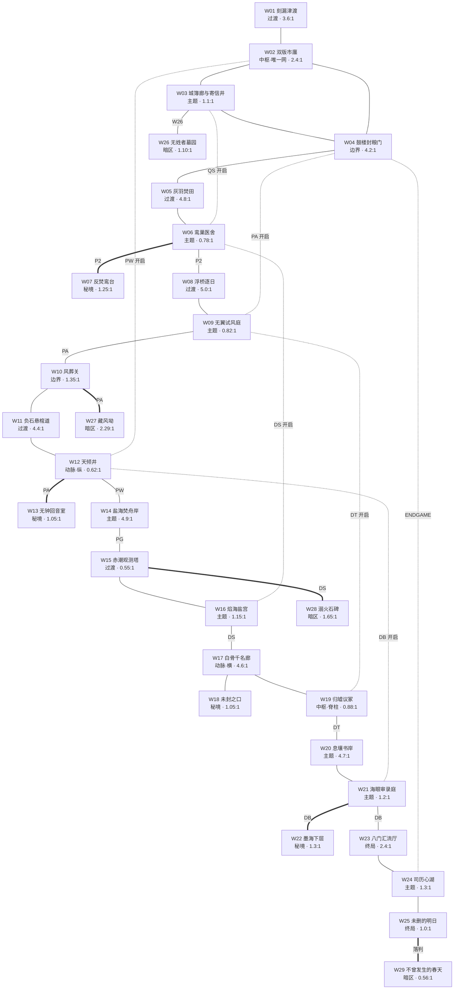

# 世界总控：29 区拓扑与章节骨架

> 状态：**已批准 v1.3**（2026-10-30）**（2026-10-30 起草 v0.1；同日回灌四项用户决策成 v0.2：房间总量 ≈320、敌人分六档并新增「精怪」、`VC` 双刻正式批准、保留 8 守印者；同日用户对五项待决事项拍板 **1A / 2A / 3B / 4A / 5A** 并升版 v1.0；同日第二批补 **§7.4 静态危险地形规范（地刺）** 与 **§7.5 平台挑战段规范**，并落 3 段可选平台挑战（W09 塔外壁 6 段 / W12 井腰裸壁 6 段 / W07 断檐外沿 4 段）与全作 18 处地刺的落区口径，升版 v1.1；同日 ① 补 **§7.4 第 8 条推挤兜底**（敌人推挤/击退/风场/平台/水位五类不得把玩家送入刺区）、② 把「精灵跨区单一个体」由潮文灵单例扩为**通用计数规则**并增刻齿灵一例、③ `data/_schema.md` 升 **v1.2**（新增 `challenges` 契约与 `shared_individual`/`counted` 字段），升版 v1.2；同日 ④ 按用户决策把 4 个内嵌暗区**全部升格为独立区**（W26 无姓者墓园 / W27 藏风坳 / W28 溺火石碑 / W29 不曾发生的春天），世界 **25 → 29 区**、房间总数仍 **320**、章节配额 `4/3/3/3/3/3/3/3` → `5/3/4/3/4/3/3/4`、新增「暗区」角色档（1—4 房、无守印者、允许无常驻灯龛），升版 v1.3）。本文件是 29 张单图文档、能力门实现、章节流程脚本的上游依据；已批准，可据以排期，但改动 `game/` 仍以单图文档 + `data/wXX.json` 为准。
> 权威边界：立项设计案《时间之神：类银河恶魔城游戏策划案（设定版）》为唯一设计基线；本文件不回写原案，凡原案未定义而由本次推导的内容标「**推导**」。
> 替代关系：本文件**取代**旧「8 章 × 6 区 = 48 区」切分。旧 48 区（`game/data/world_regions.json`，48 区 / 488 房间 / 62 连边）视为待替换实现，**不是设计依据**；但 8 个章名、章内叙事节点、守印者名号、双时代设定全部沿用，仅重新归并到 25 个区域；v1.3 起为 **29 个区域**（4 个旧内嵌暗区升格）。
> 粒度声明：本文件只到「区域」粒度。房间坐标、像素参数、单图落差与机关布置属 29 份单图文档，不在本文件。
> 配套数据源：[`data/world-25.json`](data/world-25.json)（可被脚本解析，字段与本文件第 3 节逐项对齐）。

## 0. 依据与引用

| 依据 | 用途 | 取用点 |
| --- | --- | --- |
| [`reference/hollow-knight/README.md`](reference/hollow-knight/README.md) | 形状原型库 + 8 条通用规律 | 第 2 节拓扑、第 8 节对照表、第 8.3 节相似度自查 |
| [`../../overview/project-overview.md`](../../overview/project-overview.md) | 现状与可玩边界 | 房间数量级基线、实现可承载的能力集 |
| [`../feature-time-switch.md`](../feature-time-switch.md) | 双时代规则 | 每区双时代差异必须满足「卡墙原子拒绝 / 无落点扣 1 血」 |
| [`../feature-mythic-runtime.md`](../feature-mythic-runtime.md) | 已有可运行机关 | 水路、潮位、风场、根系、升降齿轮、光路、实体音柱、三灵协作的分布 |
| [`../feature-chapter-one.md`](../feature-chapter-one.md) | 第一章战斗与补给现状 | 灯龛、魂魄、凶骨、包扎、遗落物规则 |
| `game/world_game.gd` 第 4 行 `ABILITIES` | 能力代号唯一来源 | 第 5 节代号与中文名逐字对齐 |
| `game/combat_config.gd` | 四凶流派 / 四象 / 麒麟阶 / 削韧档 | 第 6、7 节数量级（不抄具体数值） |
| [`../../art/art-bible.md`](../../art/art-bible.md) §2.6 | 时代配色规则 | 第 3.2 节双时代差异的视觉落点 |

**能力代号（唯一来源，顺序不可乱）**：`VC` 时间切换（初始）→ `P2` 凤凰二段跳 → `QS` 麒麟初识 → `PA` 凤凰空中冲刺 → `PW` 凤凰蹬墙 → `PG` 凤凰滑翔 → `DS` 龙鳞耐热 → `DT` 龙尾破壁 → `DB` 龙息冻水与酸蚀。

---

## 1. 总纲

### 1.1 为什么是 29（v1.3 前为 25）

旧 48 区是「一章六区」的等分结构，每区 5—12 房间（多数 8—12），导致三个问题：① 六区一章内必然出现纯走廊段落，过渡区不"短"而只是"小"；② 48 份面积相近的区域里，没有任何一区能承担「全高地标」（规律 4）——地标需要 12 房间以上的体量；③ 每章必定要用 6 个区塞 1 个能力，能力密度被摊薄，后 4 章几乎无能力，探索动机断档。

25 区把每区体量提升到 6—20 房间（均值 ≈12.8），世界总量 **320 房间**（区间 316—324；旧 488）。v1.3 把 4 个内嵌暗区升格后，世界变成 **29 区**，但**房间总数仍是 320**——升格只是把 4 间本来就存在的房间从"宿主区里的暗格"改登记成"独立区"，不新增一个房间。主干 25 区在 4 个宿主区各让出 1—3 间，新增的 4 个暗区各 1—3 房，全区均值 ≈11.0。**单元更大、单元更少**，换来三件事：每区可放全高地标；每章能力交付可一区完成；过渡区从"小区域"变成"短长带"（≥3.6:1，6—8 房间、上限 10），真正做到「缝合而不表现」。

房间增量**不是按区平摊 +2**，而是按角色重分配：过渡区仍压在 6—8（缝合位不膨胀），增量主要落在主题大区（14—18）、动脉（16—20）、中枢（14—18）与终局（9—14）——这些是玩家真正要"探索"而非"通过"的单元。各角色区间见 §1.3，逐区取值见 §3.1。

### 1.2 章节配额

| 章 | 章名 | 区数 | 主干区编号 | 暗区（v1.3） | 本章能力交付 |
| --- | --- | --- | --- | --- | --- |
| 1 | 断刻之城 | **5** | W01—W04 | W26 无姓者墓园 | `VC` 取得（并完成教学三连） |
| 2 | 丹丘羽坠 | 3 | W05—W07 | — | `P2` + `QS`（双能力章） |
| 3 | 羽渊悬空 | **4** | W08—W10 | W27 藏风坳 | `PA` |
| 4 | 不周断脊 | 3 | W11—W13 | — | `PW` |
| 5 | 炎狱旧海 | **4** | W14—W16 | W28 溺火石碑 | `PG` + `DS`（双能力章） |
| 6 | 归墟骨城 | 3 | W17—W19 | — | `DT` |
| 7 | 沧海息壤 | 3 | W20—W22 | — | `DB` |
| 8 | 八荒重刻 | **4** | W23—W25 | W29 不曾发生的春天 | `VC` 质变「双刻」+ 终局 |
| 合计 | — | **29** | W01—W25 | W26—W29（4 区） | 9 项（8 新能力 + 1 质变） |

`5/3/4/3/4/3/3/4` 的唯一代价是第 2、5 章各要在一章内交付两个能力（v1.3 前为 `4/3/3/3/3/3/3/3`，升格只在第 1、3、5、8 章各 +1 区，因为四个暗区的宿主区正好分布在这四章）。这两章恰是凤凰与龙的能力簇（`P2`/`QS` 同源丹丘，`PG`/`DS` 同源炎海），叙事上本就该成对出现，因此不视为缺陷；代价体现在单区容量：W06 鸾巢医舍（18 房间）与 W16 焰海盐宫（17 房间）是全作最密的两个主题大区。全作最大单区则是纵向动脉 W12 天倾井（20 房间），因为它同时承担"动脉主脉 + 守印者战场"双职能（见 §3.1 表后注）。

### 1.3 区域角色配额与角色定义

角色沿用参考作的六类，并新增「终局」与「暗区」两类（暗区为 v1.3 新增）；其中**边界**在本作被改写了语义（见下），必须先读定义再看表。

| 角色 | 配额 | 形状约束（实测值见第 3.1 节） | 本作定义 | 与参考作语义的偏离 |
| --- | --- | --- | --- | --- |
| 中枢 | ≤2 | 横条 2.4:1 / 竖井 0.88:1 | 跨章回流点。**全作只有 W02 是「网」**；W19 是脊柱型中枢（单竖井 + 三楼层），不是网 | 参考作只有十字路一个网；本作保留「只一个网」，但允许第二个非网中枢，因为 29 区的跨度比参考作的 15 区大得多 |
| 动脉 | ≤2 | 极横长 4.6:1 / 竖井 0.62:1 | 把世界两端拉通的长带。**一横一纵，且两条互不相交** | 参考作只有一条横向水道动脉；本作加一条纵向（W12），因为本作世界是「先升后降」而非单层 |
| 过渡 | 4—5 | 极横长 ≥3.6:1（4 个）或 竖塔 ≤0.6:1（1 个） | **6—8 房间**（上限 10），只做缝合。每区必须承担「第一次看到某机关的另一态」 | 语义一致，但本作的过渡区因为双时代而多一层信息职责；竖塔式过渡（W15）在参考作中没有对应 |
| 主题大区 | 6—8 | 近正方 0.9—1.5:1（4 个）/ 竖井 0.72—0.85:1（2 个）/ 极横长 ≥4.6:1（2 个） | 章内签名区，**14—18 房间**，**必有全高地标** | 语义一致；本作允许"竖井型主题大区"（W06、W09），参考作的主题大区全是平面铺开 |
| 准入秘境 | 3—4 | 近正方 1.05—1.3:1 | 需资格进入、风格割裂、单主线、**回报放在出口** | 参考作只有 1 个钥匙秘境；本作有 4 个，各对应一种能力的「资格」 |
| 边界 | 2 | 极横长 4.2:1（1 个）/ 近正方 1.35:1（1 个） | **改写**：不是"侧翼松散洞穴"，而是"章界关隘"，地形松散 + 承担章末把关 | 参考作的呼啸悬崖是可选侧翼；本作的两个边界区都在主线章界上，是必经的关门 |
| 终局 | 1—2 | 横条 2.4:1（门厅）/ 近正方 1.0:1（最终场） | 只在第八章存在，承担最终裁定 | 参考作的深渊是"下坠"；本作的终局是"判决庭" |
| 暗区（v1.3） | 4 | 近正方 1.10—1.65:1（3 个）/ 竖条 0.56:1（1 个） | **1—4 房**，一道门挂在宿主区的外墙上；**不设守印者、不设精怪、允许无常驻灯龛**（`checkpoint = null` 合法）。内容只做三件事：补一段真相、放一件回报、留一个"看得见但不该现在来"的钩子 | 参考作的"子区域/巢穴"是主线的替代路径；本作的暗区全部是**死路**——进去、拿走、原路出来，不改变世界拓扑，也不承担任何进度 |

**配额核算**：中枢 2 + 动脉 2 + 过渡 5 + 主题大区 8 + 准入秘境 4 + 边界 2 + 终局 2 = **25**；v1.3 再加**暗区 4** = **29**。主干 25 区仍是唯一满配组合（各档同时取上限），因此第 3 节主干每一行的角色都不可再调动，否则必然有另一档越界。暗区是**外挂档**：它不占主干任何一档的名额，也不改变主干的形状约束——四个暗区分别挂在第 1、3、5、8 章的宿主区外墙。

**角色房间区间（v0.2，v1.3 加暗区档）**：过渡 6—8 ／ 边界 11—13 ／ 主题大区 14—18 ／ 动脉 16—20 ／ 中枢 14—18 ／ 准入秘境 6—9 ／ 终局 9—14 ／ **暗区 1—4**（且暗区之和 ≤ 对应宿主区让出的房间数，保证总数 320 不变）。区间与角色绑定，单区调数不得越出本角色的区间——这是"总量 ≈320"能同时满足形状约束的前提；逐区实取值见 §3.1。

### 1.4 与旧 48 区的迁移映射

映射关系为「吸收」，不是「改名」。一行的 W 区吸收 1—3 个 M 区。**v1.3 起，原先标 `内嵌` 的四个 M 区已全部升格为独立暗区 W26—W29**，下表的括号里保留"原为内嵌"的痕迹以便追溯，但**现行口径是独立区**：它们有自己的单图文档、自己的 `canvas_origin`、自己的验收清单。

| 新 W 区 | 吸收的旧 M 区 | 归并理由 |
| --- | --- | --- |
| W01 刻漏津渡 | M01 无名渡口 | 单区独立保留（教学长廊需要独立的入场节奏） |
| W02 双版市廛 | M02 两版集市 | 单区独立保留（唯一网必须独占一区） |
| W03 城簿廊与寄信井 | M03 城簿廊与寄信井；**M06 无姓者墓园（v1.3 升格为 W26）** | 原判断是"只从 M03 过去态的无姓碑进入，独立成区等于给死路发区证"；v1.3 按用户决策**反转**——正因为它只有一道门、两间房，做成独立区才能有自己的形状、比例与验收清单；挂在宿主里则永远只是"宿主的一个角" |
| W04 鼓楼封粮门 | M04 鼓楼下层 + M05 封粮城门 | 鼓楼是到城门的前厅，两段同属"城缘"，合并后是完整的章末把关段 |
| W05 灰羽焚田 | M07 灰羽驿道 + M08 焚田与九年碑 | 两段同为"驿道—田"的横向过渡带，拆开则每段都太短 |
| W06 鸾巢医舍 | M09 凤凰遗巢 + M10 角闻医舍 + M11 焚城议台 | 双能力章必须把 `P2` 巢心与 `QS` 医舍放在同一区内，议台作为章末守印者场地并入 |
| W07 反焚鸾台 | M12 反焚鸾台 | 秘境独占一区（风格割裂区不能与主线共用断面） |
| W08 浮桥逐日 | M13 浮桥余索 + M14 逐日台 | 同属"悬索横渡"过渡带 |
| W09 无翼试风庭 | M15 飞瀑索院 + M16 无翼试风庭 | `PA` 取得点必须与教学庭院同区 |
| W10 风葬关 | M17 风葬关；**M18 藏风坳（v1.3 升格为 W27）** | 同上，升格为独立暗区；坳口—坳腹—坳顶三层在独立区里才有完整的竖向账 |
| W11 负石悬棺道 | M19 山前负石道 + M20 悬棺栈 | 同属"山前长坡"过渡带 |
| W12 天倾井 | M21 钟骨窟 + M22 天倾井 + M23 山口衡台 | 纵向动脉必须一口井贯通到底；PW 在井底、守印者在井口衡台，同区成立 |
| W13 无钟回音室 | M24 无钟回音室 | 秘境独占一区 |
| W14 盐海焚舟岸 | M25 盐海干岸 + M26 焚舟坞 | 同属"岸—坞"横向动脉段 |
| W15 赤潮观测塔 | M27 赤潮观测塔；**M30 溺火石碑（v1.3 升格为 W28）** | 同上，升格；**全作最小的一区（1 房 / 528×320）**，升格的价值不在体量而在"它有自己的准入能力（`DS`）与唯一的双层道具" |
| W16 焰海盐宫 | M28 蜕鳞温洞 + M29 焰海盐宫 | `DS` 温洞在盐宫背面，合并后是"绕后取鳞再正面进宫" |
| W17 白骨千名廊 | M31 白骨潮门 + M32 千名骨廊 + M33 缄口水仓 | 横向动脉必须贯通；三段同为骨梁廊道 |
| W18 未封之口 | M36 未封之口 | 秘境独占一区 |
| W19 归墟议冢 | M34 龙尾葬台 + M35 归墟议冢 | `DT` 葬台与议冢同为脊柱中枢的两层 |
| W20 息壤书岸 | M37 潮退书岸 + M38 息壤育床 | 同属"岸—床"主题段 |
| W21 海眼审录庭 | M39 海眼旧庭 + M40 龙息双泉 + M41 潮文审录所 | `DB` 双泉、章末审录所与旧庭同属一个庭园 |
| W22 墨海下层 | M42 墨海下层 | 秘境独占一区 |
| W23 八门汇流厅 | M43 八门汇流厅 + M44 逆历档案塔 | 门厅与塔体共构终局前厅 |
| W24 司历心湖 | M45 司历心湖 + M46 重刻齿轮场 | 心湖在齿轮场中央，同区才有"场围着湖转"的地标效果 |
| W25 未删的明日 | M47 未删的明日；**M48 不曾发生的春天（v1.3 升格为 W29）** | 原判断是"独立成区会破坏结局→回看的顺序"；v1.3 升格后该顺序**由旗标保证**（`w25_verdict_sealed` 未置位时东墙是实心名单墙），顺序不破，而暗区能拿到自己的"无时代"规格（全作唯一"双时代差异 0 处"的豁免区） |

**净变化**：48 → **29 区**（v1.2 为 25 区，v1.3 把四个内嵌暗区升格）；4 个旧独立秘境（M12 / M24 / M36 / M42）从一开始就保留为独立 W 区，另 4 个（M06 / M18 / M30 / M48）先降为内嵌暗区、v1.3 再升格为 **W26—W29**；房间节点 488 → **320**（**升格前后都是 320**——升格不新增房间，只是改登记）；连边 62 → **36**（主干 32 条 + 暗区 4 条）。旧 `M` 编号在新世界**全部作废**，不得在后续文档中继续引用。

---

## 2. 世界拓扑图

### 2.1 空间逻辑（先看这张，再看 Mermaid）

世界是一条**先升后降的竖环**：断刻之城（中位）→ 丹丘（上行）→ 羽渊（最高）→ 不周断脊（沿山脊下行）→ 炎狱旧海（海平面下）→ 归墟骨城（最低）→ 沧海息壤（海床横向）→ 八荒重刻（最低处，终局）。玩家在第 3 章登顶、在第 4—6 章一路下坠到底，这个"上—下"的落差本身就是全作最大的地标。

```
【上行】
第1章  W01 ── W02 ─┬─ W03 ── W04          三角环 = 全作唯一网；W04 守印者·报丧鼓将
                  │        │  〔W26 墓园·暗区，挂 W03 西墙〕
                    │        │
                    └────────┘
第2章  W05 ── W06 ─┬─ W07（秘境·P2）
                    ├─ 守印者·燧羽侯（议台）
                    └─（QS 回环→W03）
第3章  W08 ── W09 ── W10                  W10 守印者·巡空监路使；〔W27 藏风坳·暗区，挂 W10 北墙〕
                       └─（PA 回环→W04）
第4章  W11 ── W12 ─┬─ W13（秘境·PA）      W12 纵向动脉；井底 PW；井口守印者·担山傀
                    └─（PW 回环→W02）
【下行】
第5章  W14 ── W15 ── W16                  W16 守印者·借火龙骸；〔W28 溺火石碑·暗区，挂 W15 北墙〕
                       └─（DS 回环→W06）
第6章  W17 ─┬─ W18（秘境）                W17 横向动脉
             └─ W19                        W19 脊柱中枢；DT；守印者·百口墓钟
                    └─（DT 回环→W09）
第7章  W20 ── W21 ─┬─ W22（秘境·DB）
                    ├─ 守印者·司历校稿者（审录所）
                    └─（DB 回环→W12）
第8章  W23 ── W24 ── W25 ─ 〔W29 春天·暗区，挂 W25 东墙〕   W25 BOSS·司历·删稿相
                       └─（ENDGAME 进度门→W04）
```

`──` 主路；`└─（X 回环→Wxx）` 由能力在**新章一侧**开启的跨章捷径，括号内标能力代号；`ENDGAME` 为进度旗标而非能力，见 §5.3；`〔Wxx …·暗区〕` 为 v1.3 升格的四个暗区，**一律挂在宿主区的外墙上、一律是死路**（进去、拿走、原路出来），不进主干链、不进任何进度。

### 2.2 连通图（Mermaid）

线型图例：`---` 主路；`-.-` 能力回环（虚线，需后缀能力才通行）；`===` 秘境侧枝（死路，但同边可返）。



> 图例补充：`-.-` 虚线中，6 条标能力代号的回环边由**能力本身**兼任进度门（该能力只能在新章一侧取得，旧章玩家不可能提前持有）；`ENDGAME` 一条是**无能力约束的跨 7 章边**，单独用进度旗标封堵，见 §5.3。
> **暗区四条边（v1.3）**：W03↔W26（无门槛）、W10↔W27（`PA`）、W15↔W28（`DS`）、W25↔W29（`w25_verdict_sealed` 进度旗标）。四条都是**双向死路**，不计入"秘境"计数（秘境仍是 W07/W13/W18/W22 四个）。

### 2.3 结构自查

| 检查项 | 结果 |
| --- | --- |
| 无向连通 | ✓ **29 节点 36 边**（25 节点 32 边 + 4 个暗区 4 边），单连通分量，无孤立点 |
| 唯一网 | ✓ 全作唯一的三角环 = W02—W03—W04—W02；其余区域均为「一主脉 + 支脉」；**四个暗区一律是叶子**，不参与任何环 |
| 单横动脉 / 单纵动脉 | ✓ W17（4.6:1 横向）/ W12（0.62:1 纵向），两者不相交 |
| 死锁 | ✓ 无单向不可逆边。4 个秘境均为「同边往返」侧枝；全作落差处一律配回升梯或风绳（沿用旧设计惯例） |
| 能力门位置 | ✓ 每个门都在「取得点之后」或「同区取得点旁边」，不存在需先行通过才能取得的能力 |
| 枚举度数 | 度 1：W01（世界入口）、W07/W13/W18/W22（秘境）、**W26/W27/W28/W29（暗区）**——全部可原路返回；W25 自 v1.3 起为**度 2**（西 W24 + 东 W29） |

---

## 3. 区域总表

### 3.1 主表（29 行）

宽高比 = 区域外框的 **宽 : 高**（不是单房间）。「出入口」的方位指在该区断面上的相对方位。**v1.3 起没有「内嵌」**：暗区是独立的 W26—W29 四行，各自只有 1 个出入口，挂在宿主区的外墙上。

| 编号 | 区名 | 章 | 世界图角色 | 形状原型 | 宽高比 | 房间 | 主要出入口 | 能力门 | 双时代差异（一句话） | 守印者 / 秘境 |
| --- | --- | --- | --- | --- | --- | --- | --- | --- | --- | --- |
| W01 | 刻漏津渡 | 1 | 过渡（教学长廊） | 极横长 + 末段竖井 | 3.6:1 | 7 | 1（东→W02；西为世界起点） | 无（末段取得 `VC`） | 过去石桥完整可走通；现在桥断三段、下为安全浅滩——初访必在桥心切时落滩，再从过去态爬回桥面，这是第一次被迫换边 | — |
| W02 | 双版市廛 | 1 | 中枢（唯一网） | 横条·三角环 | 2.4:1 | 17 | 4（西 W01 / 北 W03 / 东 W04 / 南↓ W12） | 无 | 过去布棚与摊位形成上层通路；现在石架与屋顶形成下层环道——同一空间两套环，主线各走一套 | — |
| W03 | 城簿廊与寄信井 | 1 | 主题大区 | 近正方·三层 | 1.1:1 | **15** | 4（南 W02 / 东 W04 / **西 W26 暗区** / 西北↖ W06 回环，后期） | 无 | 过去卷宗架全开、井口未封；现在井口被石板封死——可在过去走进井壁再切回现在，落进封板之下（跨时代穿墙教学） | **暗区 W26 无姓者墓园**（v1.3 独立） |
| W04 | 鼓楼封粮门 | 1 | 边界（城缘关隘） | 极横长 | 4.2:1 | 12 | 5（西 W03 / 西 W02 / 东 W05 / 北↑ W09 / 南↓ W24，`ENDGAME` 进度门） | 无（南侧 W24 为进度门，非能力门） | 过去城门有车辙与通关木牌、鼓索完好可拉旧升降台；现在封条覆门、木梯坍塌，改由墙内跳路与断索下行 | **守印者·报丧鼓将** |
| W05 | 灰羽焚田 | 2 | 过渡（横向过渡带） | 极横长 | 4.8:1 | 8 | 2（西 W04 / 东 W06） | 无 | 过去运粮车列与稻草垛连成上层踏面；现在焦土低洼、车辙成沟——主路靠两态交替踏面推进 | — |
| W06 | 鸾巢医舍 | 2 | 主题大区 | 竖井（自下而上） | 0.78:1 | 18 | 5（西 W05 / 东 W08 / 东南↘ W07 / 西北↖ W03 / 西→W16 回环，后期） | 无（内嵌 `P2`、`QS` 取得） | 过去巢体完整、药架高悬；现在巢只剩燃羽、仓房封门——医舍只在现在可入，巢心只在过去可登 | **守印者·燧羽侯**（议台） |
| W07 | 反焚鸾台 | 2 | 准入秘境 | 近正方 | 1.25:1 | 7 | 1（西北→W06） | **`P2`** | 过去是会合台与断檐；现在只剩灰色空笼——同意书背面只有过去可读，且必须从现在的断檐起跳 | 秘境（风格割裂：暖赭金、无杂兵） |
| W08 | 浮桥逐日 | 3 | 过渡（悬索横渡） | 极横长 | 5.0:1 | 7 | 2（西 W06 / 东 W09） | 无 | 过去桥板连续、日影钟完整；现在只剩风蚀吊索与错位影子——安全风向靠两代影子的差值读出 | — |
| W09 | 无翼试风庭 | 3 | 主题大区 | 竖井（向天攀） | 0.82:1 | 17 | 4（西 W08 / 东 W10 / 北↑ W04 回环 / 东→W19 回环，后期） | 无（内嵌 `PA` 取得） | 过去瀑布成水幕遮住路线；现在只余空槽——过去挡视线、现在露结构，两个时代各给半张地图 | — |
| W10 | 风葬关 | 3 | 边界（山风关隘） | 近正方 | 1.35:1 | **9** | 3（西 W09 / 东 W11 / **北↑ W27 暗区**） | `PA`（西侧入口） | 过去可踩旗杆登关；现在旗断而岩柱起——关门两侧各有一套升降路径 | **守印者·巡空监路使**；**暗区 W27 藏风坳**（v1.3 独立） |
| W11 | 负石悬棺道 | 4 | 过渡（山前长坡） | 极横长 | 4.4:1 | 7 | 2（西 W10 / 东 W12） | 无 | 过去石阶整齐可直上；现在整条斜坡、落石槽加深——上下行路线完全不同 | — |
| W12 | 天倾井 | 4 | 动脉（纵向） | 竖井（全高地标） | 0.62:1 | 20（其中 4 间为守印者战场房） | 5（西 W11 / 东 W14 / 井壁 W13 / 井顶↑ W02 / 井底↓ W21） | `PW`（出井唯一手段） | 过去钟骨共鸣使平台周期摆动；现在骨架固定成底道——同一口井，两个时代是"活井"与"死井" | **守印者·担山傀**（井口衡台） |
| W13 | 无钟回音室 | 4 | 准入秘境 | 近正方 | 1.05:1 | 7 | 1（井壁→W12） | **`PA`** | 过去能听见记录员删稿的过程；现在由回音结晶重建断句——两态各存一半信息，要拼才有全录音 | 秘境（风格割裂：无钟、无声、全灰） |
| W14 | 盐海焚舟岸 | 5 | 主题大区 | 极横长 | 4.9:1 | 16 | 2（西 W12 / 东 W15） | 无（内嵌 `PG` 取得） | 过去海水尚在岸边、船浮成横梁；现在盐壳可站、船骨搁浅——岸线位置本身在变 | — |
| W15 | 赤潮观测塔 | 5 | 过渡（竖向存取） | 竖井 | 0.55:1 | **5** | 3（西 W14 / 东 W16 / **北↑ W28 暗区**） | `PG`（跨盐风带） | 过去测潮仪仍在运转、潮位刻度可读；现在塔壁结满晶盐、读数被埋——潮位只有过去能读 | **暗区 W28 溺火石碑**（v1.3 独立） |
| W16 | 焰海盐宫 | 5 | 主题大区 | 近正方 | 1.15:1 | 17 | 3（西 W15 / 东→W17 / 北↑ W06） | 无（内嵌 `DS` 取得） | 过去盐宫靠退潮后可站的水廊通行；现在整片热地，非 `DS` 不可过 | **守印者·借火龙骸** |
| W17 | 白骨千名廊 | 6 | 动脉（横向） | 极横长 | 4.6:1 | 18 | 3（西 W16 / 东 W19 / 廊侧 W18） | 无 | 过去潮水高涨、骨梁半没；现在潮落骨梁全露——同一廊道在水位两端是两条不同路线 | — |
| W18 | 未封之口 | 6 | 准入秘境 | 近正方 | 1.05:1 | 8 | 1（廊侧→W17） | 无（深层房间需 `DT`） | 过去水仓干燥、病房仍有人；现在上层可通、下层涨水、船骸倒扣成洞 | 秘境（风格割裂：无 UI、灰阶、无文字） |
| W19 | 归墟议冢 | 6 | 中枢（脊柱，非网） | 竖井·三楼层 | 0.88:1 | 18（其中 4 间为守印者战场房） | 3（西 W17 / 东 W20 / 北↑ W09） | 无（内嵌 `DT` 取得） | 过去议冢开放、葬台尚空；现在议冢被指定脆壁封存——`DT` 破封后两态才都能回行 | **守印者·百口墓钟** |
| W20 | 息壤书岸 | 7 | 主题大区 | 极横长 | 4.7:1 | 16 | 2（西 W19 / 东 W21） | `DT`（西侧封壁） | 过去潮头高、息壤仍是泥板；现在沙洲连成陆块、息壤层层隆起——海拔本身在两态间变化 | — |
| W21 | 海眼审录庭 | 7 | 主题大区 | 近正方 | 1.2:1 | 17 | 4（西 W20 / 东 W23 / 庭侧 W22 / 北↑ W12） | 无（内嵌 `DB` 取得） | 过去仪式庭下层干燥、心湖浅；现在水庭成池、湖面泛墨——`DB` 冻的是现在的水，过去本就干 | **守印者·司历校稿者** |
| W22 | 墨海下层 | 7 | 准入秘境 | 近正方 | 1.3:1 | 8 | 1（庭侧→W21） | **`DB`** | 过去是封存的修订沙盘（无水）；现在整层被淹——地图只对过去有效，现在的地图是过期的 | 秘境（风格割裂：纯黑白水墨，撤"现在态地图"） |
| W23 | 八门汇流厅 | 8 | 终局（门厅） | 横条 + 塔体 | 2.4:1 | 13 | 2（西 W21 / 东 W24） | `DB`（西侧酸壳） | 过去八门各通不同地景（八条真路）；现在归并为一条公共廊——过去态是全作唯一的"八向"结构 | — |
| W24 | 司历心湖 | 8 | 主题大区 | 近正方 | 1.3:1 | 17（其中 3 间为终局裁决厅/证据台账厅） | 3（西 W23 / 东 W25，`FINAL_DOOR` 进度门 / 北↑ W04，`ENDGAME` 置位侧） | 无（内嵌 `VC` 质变「双刻」；东、北均为进度门） | 过去齿轮全速运行、纸本楼梯可走；现在齿轮被酸壳卡住、楼梯断成台——重刻场两态是"在转"与"停住" | — |
| W25 | 未删的明日 | 8 | 终局（最终） | 近正方 | 1.0:1 | **8** | 2（西 W24 / **东→W29 暗区**，`w25_verdict_sealed` 进度门） | 无 | 过去是未删的明日（理想投影、无灾民）；现在投影下压着真实灾民名单——两态差异是"承诺"与"凭据" | **BOSS·司历·删稿相**；**暗区 W29 不曾发生的春天**（v1.3 独立） |
| W26 | 无姓者墓园 | 1 | **暗区** | 矩形（两层叠置） | 1.10:1 | 2 | 1（东→W03 井底南口西墙） | 无 | 过去态园门是拱洞、无姓碑上 41 个名字清晰、石阶完整；现在态碑面被刮成麻面、园门是实心墙、石阶塌成两截——**墓园只存在于过去** | **暗区**（无守印者、无常驻灯龛） |
| W27 | 藏风坳 | 3 | **暗区** | 分叉团块（一横一竖一深） | 2.29:1 | 3 | 1（南→W10 风口西廊北墙） | `PA` | 过去态坳内无风、存粮架完整、水缸满；现在态坳内灌风、粮架倒伏、坳底被风磨出深沟（可下到更低处） | **暗区** |
| W28 | 溺火石碑 | 5 | **暗区** | 拱顶 | 1.65:1 | 1 | 1（南→W15 塔顶观测台北墙） | `DS` | 过去态碑面空白、碑体冰凉；现在态熔岩渗流从碑底上冒，热浪把碑文烤显形——**碑文只在现在可读，而现在必须持 `DS`** | **暗区**（全作最小一区，1 房） |
| W29 | 不曾发生的春天 | 8 | **暗区** | 矩形（竖向两段） | 0.56:1 | 2 | 1（西→W25 原告席东墙） | 无（门槛为进度旗标 `w25_verdict_sealed`） | **本区没有时代**：纯白宣纸、无灰阶、无敌人、切时无效，HUD 时代指示器整个撤掉——全作唯一「双时代差异 0 处」的豁免区 | **暗区**（全作唯一无时代区） |

> **双职能区的战场房单列（v0.2 硬约束）**
> 本表「房间」列合计 **320**（区间 316—324，均值 ≈12.8），按角色区间分配，不做逐区平摊。
> **W12 天倾井**（动脉 + 守印者）与 **W19 归墟议冢**（中枢 + 守印者）两区，守印者战场**必须占用独立房间并已计入房间总数**：不得与动脉主脉／中枢竖井共用同一房间的通行空间——**战期锁门，战后开放为通路**。其中 W12 计 4 间（井口衡台 + 衡台前厅 + 战期封锁环 + 战后通路），W19 计 4 间（议冢主厅 + 投影层 + 封锁环 + 战后通路）。
> **W24 司历心湖**虽无 Boss，但其 `FINAL_DOOR` 前庭与证据台账登记厅（3 间）同样独立成房并计入总数，不与重刻场的通行空间重叠；该 3 间是"终局仪式房"而非 Boss 场，单图文档不得为它虚构 Boss。
> 因此三区不得再被按"纯通道"压缩房间数；后续若调整总量，只能在本角色的房间区间内浮动。
>
> **四个暗区（v1.3，W26—W29）**：房间 2 / 3 / 1 / 2，合计 **8 间**，正好等于四个宿主区让出的房间数（W03 −2、W10 −3、W15 −1、W25 −2），因此 **320 总数不变**。四条共同约束：① **一律是叶子**——只有一道门、不通第二区、进去原路出来；② **一律不设守印者、不设精怪**，可以没有敌人，也可以没有灯龛（`checkpoint = null` 合法，`data/_schema.md` v1.3 已放宽校验）；③ **一律不吃能力配额**——W27 要 `PA`、W28 要 `DS`，都只是复用已取得的能力，暗区不交付任何能力；④ **一律不改世界拓扑**——它们的边不计入主干 32 边，另计 4 条。"暗区"这一档的存在意义只有一个：**让一段本就写好、但只有一两间房的内容，拿到它自己的形状、比例、时间与验收清单**，而不是永远当宿主区的一个角。

### 3.2 双时代表（写作约束）

第 3.1 节的「双时代差异」列不是氛围描述，而是**通行差异**：每一句都必须能被单图文档落成「过去可走 / 现在不可走」的成对路线。写作时按下表四条硬约束执行，颜色只作辅助（[art-bible §2.6](../../art/art-bible.md)：过去 `#202849` 暖紫蓝底 + 赭褐地形 `#BC8C64`，现在 `#142032` 冷深蓝底 + 冷灰地形 `#657987`）。

| 约束 | 要求 | 反例（禁止） |
| --- | --- | --- |
| 通行必须变 | 两态至少各有一条对侧不可通行的路线，且主线必须交代 | "现在雾更浓"这类纯氛围差异 |
| 卡墙拒绝可用 | 差异造成的墙体必须是实体碰撞，允许玩家体验「当前位置无法使用该能力」 | 用不可见禁区或坐标限制代替地形 |
| 无落点分支留白 | 允许切时后无落点扣 1 血并安全安置，但主线不可依赖该分支通过 | 把主线出口设在悬空点靠扣血落地 |
| 反向可读 | 玩家应能在 A 态看到 B 态将要出现的结构（虚影/残痕），不允许纯记忆题 | 两态完全无关、必须背版 |

### 3.3 机关分布（沿用已实现机制）

[`feature-mythic-runtime.md`](../feature-mythic-runtime.md) 的八类机关已可运行，29 区必须按「能力—机关」对齐分配，避免机关变成无门槛装饰：

| 机关 | 主要落区 | 与能力的钩子 |
| --- | --- | --- |
| 水路改道 / 潮位蓄泄 | W14、W17、W21 | 水位由 `VC` 改变（过去潮高 / 现在潮低），`DB` 可冻结现在的水 |
| 风场穿行 | W08、W09、W14 | `PG` 减速 + 上升气流；`PA` 穿越横风 |
| 根系生长 | W20、W22 | `DT` 破壳 → 根系重接，两态根桥走不同层 |
| 机关重构（升降齿轮） | W12、W19、W24 | 中枢 W19 的"电梯"即此机关；W24 齿轮两态在转/停住 |
| 光影辨伪 | W03、W13、W18 | 无光源时代（现在）需靠过去的光路反推 |
| 回声记忆（实体音柱） | W13、W19、W25 | 与"被删的声音"主线强绑，W13 秘境为纯回声区 |
| 三灵协作 | W06、W16、W21 | 三处能力取得点的收束机关（水轮/风轮/地脉各一） |

---

## 4. 章节推进路线

每章固定四段：**主线区序 → 支线区 → 能力取得点 → 章末守印者**；并给出「首次进入状态 → 章末状态」的能力增量。数值只写代号与数量级，具体数值由 `combat_config.gd` 决定。

### 第 1 章 · 断刻之城（W01—W04 + 暗区 W26）

- 主线：W01 → W02 → W03 → W04。W02—W03—W04 构成三角环，可从 W02 直下 W04，也可绕 W03 读文书再进；两条都通 Boss 门。
- 支线：**W26 无姓者墓园**（独立暗区，挂 W03 西墙；过去态触摸无姓碑进入，无能力门，可初访即通）；W02 店摊对照（过去粮票 vs 现在祭纸，三次对照解锁档案）。
- 能力取得：`VC` 在 W01 末段刻漏取得。教学三连：① 桥心切换跨断层；② 井壁跨时代穿墙（W03）；③ 卡墙拒绝试台（W02 市廛侧巷，过去态站进墙体虚影按 Tab，看到「当前位置无法使用该能力」且不扣血）。
- 章末守印者：**报丧鼓将**（W04 城门内侧）。三拍预告地面波、两拍后退给攻击与治疗窗口，不禁疗；失败复位于门前。
- 能力增量：无 → `VC`（含跨时代穿墙的完整用法）。

### 第 2 章 · 丹丘羽坠（W05—W07）

- 主线：W04 → W05 → W06 →（守印者 燧羽侯）→ W07（可选）→ W08。
- 支线：W07 反焚鸾台（`P2` 准入）；W05 车辙饭勺（两时代同物定位被藏新仓，非硬锁）。
- 能力取得：`P2` 在 W06 巢心（过去态登巢触发），紧随软垫练习房；`QS` 在 W06 医舍（现在态可入），生命上限 4→6、灯龛恢复。
- 章末守印者：**燧羽侯**（W06 议台）。长前摇落羽 + 羽雨间隔 + 跪地喘息给出四流派攻击/回复窗口。议台入口需 `P2` 跨断裂环梁——这是 `P2` 的首次主线应用。
- 能力增量：`VC` → `VC` + `P2` + `QS`。血量翻倍与二段跳同时到位，是第一个"能力爆炸"章。

### 第 3 章 · 羽渊悬空（W08—W10 + 暗区 W27）

- 主线：W06 → W08 → W09 → W10。
- 支线：**W27 藏风坳**（独立暗区，挂 W10 北墙；`PA` 准入，`PW` 后开高层风标）；W08 航图双份（两时代指向相反，须对照）。
- 能力取得：`PA` 在 W09 试风庭（过去态触碰凤凰第二羽），训练为 `P2`→空冲跨有缓冲底板的断层。
- 章末守印者：**巡空监路使**（W10 关门）。风标预告跃击，`PA` 可避、地面回身亦可避；每轮落地后开治疗窗。
- 能力增量：`P2` → `P2`+`PA`（垂直—水平两向机动成型）。

### 第 4 章 · 不周断脊（W11—W13）

- 主线：W10 → W11 → W12（井底取 `PW` → 沿井壁上升 → 井口担山傀）。
- 支线：W13 无钟回音室（`PA` 准入，`PW` 后可到高层档案）。
- 能力取得：`PW` 在 W12 井底。教学三阶：低墙 → 相向墙 → `P2`+`PA`+`PW` 组合上升。蹬墙仅识别"可蹬材质"标签，全章材质一致（可读性优先于写实）。
- 章末守印者：**担山傀**（W12 井口衡台）。抬臂后砸落，破绽在锁链松弛期；破甲可加速但绝不强制某一流派。
- 能力增量：`PA` → `PW`。本章只有 1 个能力，但把前三个能力全部变成"井壁连段"，是全作机动性的收束章。
- 结构说明：本章无主题大区——**纵向动脉（W12）本身就是主体**。这是 25 区下唯一"动脉即章"的安排。

### 第 5 章 · 炎狱旧海（W14—W16 + 暗区 W28）

- 主线：W12 → W14 → W15 → W16（盐宫背面温洞取 `DS` → 正面进宫 → 借火龙骸）。
- 支线：**W28 溺火石碑**（独立暗区，挂 W15 北墙；`DS` 准入；`DT` 后可破碑下脆层取龙族日记）。
- 能力取得：`PG` 在 W14 冷岸风庭（低台滑翔 + 上升气流 → 跨盐风带去 W15）；`DS` 在 W16 蜕鳞温洞（短热砂 → 低流量熔岩廊）。
- 章末守印者：**借火龙骸**（W16 盐宫正殿）。火波有地面预兆，近身喘息可疗伤。**龙鳞只处理地形危险，不为 Boss 减伤**——这条必须在单图文档里写成明确提示，否则玩家会误以为 `DS` 是战斗防御。
- 能力增量：`PW` → `PG` + `DS`。第二个双能力章。

### 第 6 章 · 归墟骨城（W17—W19）

- 主线：W16 → W17 →（侧枝 W18 可选）→ W19（葬台取 `DT` → 破议冢封壁）。
- 支线：W18 未封之口（无能力门可初访；深层房间需 `DT`，取出妻子私人信，不开 Boss 路）。
- 能力取得：`DT` 在 W19 龙尾葬台。取得后立刻对同纹理薄骨墙练习，再破地板露出等价路线；**不可破非标记地形**，墙态永久保存且两态分别记录。
- 章末守印者：**百口墓钟**（W19 议冢）。召出录音投影，本体攻击预警明确；投影可快清但不必须。
- 能力增量：`DT` 就位。本章无主题大区——**脊柱中枢（W19）本身就是主体**，全作唯一的"中枢即章"。

### 第 7 章 · 沧海息壤（W20—W22）

- 主线：W19 → W20 → W21（双泉取 `DB` → 审录庭 司历校稿者）。
- 支线：W22 墨海下层（`DB` 准入；深处有 `DT` 脆壁与 `DB` 蚀壳两条可选回环，都能返 W21）。
- 能力取得：`DB` 在 W21 龙息双泉。教学顺序固定：冻浅水成台 → 站定 → 酸蚀指定壳 → 「冻水→站稳→蚀门」组合。输入按当前锁定目标类型决定（水用冻、蚀壳用蚀），并列时准星取最近有效目标并可手动切换。
- 章末守印者：**司历校稿者**（W21 审录所）。依次投影七地互相矛盾的证词，招式有固定电报码；不需要答对剧情问答才能赢。
- 能力增量：`DT` → `DB`。

### 第 8 章 · 八荒重刻（W23—W25 + 暗区 W29）

- 主线：W21 → W23 → W24 → W25。
- 支线：**W29 不曾发生的春天**（独立暗区，挂 W25 原告席东墙；`w25_verdict_sealed` 落判后开放，纯叙事门非真结局门，**双时代差异 0 处**——全作唯一豁免区）；W24 逐章证词对照七组（不要求全做）。
- 能力取得：`VC` 质变「**双刻**」（W24 心湖，**已批准 · 2026-10-30**）：切换时代时另一时代的地形以虚影同时显形，可在不切换的情况下读对侧结构。这是全作唯一一次"旧能力变强"，交付的是**信息**而不是位移（硬边界见 §8.2）——终局的 Boss 二阶段会强制换时代，双刻让玩家第一次能"同时看两边"。
- 章末守印者 → BOSS：**司历·删稿相**（W25）。第一阶段投影已知旧路（守印者档），第二阶段将地形切到另一时代（BOSS 档，每次都留安全落脚与明显预告）；四基础流派伤害窗口等价，麒麟治疗不被禁用，Boss 前存档。
- 终局前回访：W24 完成证据台账登记后置位 `ENDGAME`，开启 W24→W04 的旧总钟道，玩家可在打最终 BOSS 前回第 1 章补完支线与收集；**反向不成立**——W04 侧在置位前是实体墙（见 §5.3）。
- 能力增量：`DB` → `DB` + `VC@双刻`。
- 结局口径：两个选择（公开原件+隐私延时 / 公开原件+隐私托管）都要求可追责与异议机制，差异体现为七地代表的政治成本与尾声，不做善恶二元。

### 4.1 章末状态总表

| 章 | 首次进入时持有 | 章末持有 | 本章新增通关手段 |
| --- | --- | --- | --- |
| 1 | — | `VC` | 换边、跨时代穿墙、卡墙拒绝 |
| 2 | `VC` | `VC` `P2` `QS` | 二段跳、6 格血与灯龛恢复 |
| 3 | `VC` `P2` `QS` | +`PA` | 空中冲刺 |
| 4 | …`PA` | +`PW` | 蹬墙（井壁连段） |
| 5 | …`PW` | +`PG` `DS` | 滑翔、耐热通路 |
| 6 | …`PG` `DS` | +`DT` | 破壁（永久改变两态地形） |
| 7 | …`DT` | +`DB` | 冻水成台 / 蚀壳开路 |
| 8 | …`DB` | +`VC@双刻` | 双时代同显 |

---

## 5. 能力门闭环表

每个能力必须有「取得区 → 首次使用 → 回访捷径 → 若跳过的后果」四段。所有门的共性规则：**门只在取得点之后（或同区取得点旁）出现**；**没有任何门需要先通过才能取得对应能力**；**回环边一律从新章一侧开启**（旧区不能提前进入新章）——其中 6 条由能力代号天然封堵，1 条需进度旗标，见 §5.3。

| 能力 | 取得区（地点） | 首次使用场景 | 回访打开的捷径 | 若未取（含"跳过/延后"）的后果 |
| --- | --- | --- | --- | --- |
| `VC` 时间切换 | W01 刻漏津渡 · 末段刻漏 | W01 桥心切时落浅滩；W03 井壁跨时代穿墙 | 无（是全作地基，不设回环） | 不可能跳过：W01 西端为世界起点，`VC` 是进入 W02 的唯一手段 |
| `P2` 凤凰二段跳 | W06 鸾巢医舍 · 过去态巢心 | ① W06 议台断梁（主线）；② 软垫练习房（无惩罚） | W06→W07 秘境入口；W05 上层布棚；W02 高处绳铃（战技残篇） | 卡在 W06：议台断梁过不去，无法进章末守印者场。**不是软锁**——`P2` 就在本区，回头 2 房间即可取 |
| `QS` 麒麟初识 | W06 鸾巢医舍 · 现在态医舍 | 取得即生效（生命 4→6、灯龛恢复）；第一次实战检验是 燧羽侯 | W06→W03 药商旧隧道（双向，开启后可从前四章直接回 W06） | 可跳过（医舍在支路侧门内）。后果：以 4 格血打 燧羽侯与全第 3 章，且灯龛不恢复——属"高难度但可通过"，不做硬锁 |
| `PA` 凤凰空中冲刺 | W09 无翼试风庭 · 过去态第二羽 | ① 试风庭断层（`P2`+`PA` 组合）；② W09→W10 关门西侧横风口（主线） | W09→W04 鼓楼升降索（双向，前四章快速回 W09）；W13 秘境入口 | 卡在 W09：无法过 W10 关门。**不是软锁**——`PA` 在本区 |
| `PW` 凤凰蹬墙 | W12 天倾井 · 井底石工亲笔信旁 | 井壁三阶教学（低墙 → 相向墙 → 组合上升） | W12→W02 旧排水渠（井顶开启，直接回到唯一网中枢） | 卡在井底：出井唯一手段是 `PW`。这是全作**唯一"必须用新能力离开取得室"**的门，因为井底就是取得室，风险为零 |
| `PG` 凤凰滑翔 | W14 盐海焚舟岸 · 冷岸风庭 | ① 冷岸低台滑翔 + 上升气流；② 跨盐风带去 W15（主线） | W15 塔顶风廊（`PG` 才可长距横渡，打开后成为 ch5 内部快线） | 卡在 W14：盐风带需减速横渡，无 `PG` 必被吹回。**不是软锁**——`PG` 在本区 |
| `DS` 龙鳞耐热 | W16 焰海盐宫 · 蜕鳞温洞 | ① 短热砂 → 低流量熔岩廊（取得室教学）；② 盐宫正殿热地（主线） | W16→W06 热风旧道（双向，第 1—2 章可直达炎海）；**W28 溺火石碑**（暗区） | 卡在 W16：进宫唯一的非热路径在取得室之后，无 `DS` 到不了 借火龙骸 |
| `DT` 龙尾破壁 | W19 归墟议冢 · 龙尾葬台 | ① 同纹理薄骨墙（取得室练习）；② 议冢封壁（主线，破后两态都能回行） | W19→W09 归墟旧航道（双向，直达第 3 章）；W18 深层房间；W15 溺火石碑碑下脆层 | 卡在 W19：议冢封壁两态皆封，无 `DT` 出不去本章。另：跳过 `DT` 会让 W18 深层、W15 碑下、W13 高层档案永久拿不到（不影响主线，影响档案完整度） |
| `DB` 龙息冻水与酸蚀 | W21 海眼审录庭 · 龙息双泉 | ① 安全低水池冻水平台；② 并行通道蚀壳开门（主线） | W21→W12 旧钟水道（双向，直达纵向动脉）；W22 秘境入口；W23 西侧酸壳 | 卡在 W21：审录所被酸壳与浅水隔断，`DB` 为本章主线必需。另：可回访 W17 潮门（冻浅水抄近路），但不作为开门条件 |
| `VC@双刻`（质变） | W24 司历心湖 · 湖心 | 明日之门前：不切换即可读对侧结构 | 无新捷径；开放 **W29 不曾发生的春天**（暗区） | **已批准交付项**：影响真相补遗与尾声旁白（只交付信息、不交付位移，边界见 §8.2）。结局主线不需要 `双刻` |

### 5.1 能力顺序证明

`VC` → `P2` → `QS` → `PA` → `PW` → `PG` → `DS` → `DT` → `DB`，与任务给定的顺序表**逐项一致**，且与取得区章节序严格单调（1 → 2 → 2 → 3 → 4 → 5 → 5 → 6 → 7）。`QS` 与 `P2` 同区（W06）但 `QS` 的取得不依赖 `P2` 之外任何能力，二者内部次序可互换——这一点被显式允许（旧设计 M10 亦注明"不要求先拿 QS"）。

### 5.2 死锁审计

| 潜在死锁 | 检查结果 |
| --- | --- |
| 秘境单向坠落 | 无。4 个秘境（W07/W13/W18/W22）均为同边往返，且入口都在高处，回报在出口侧 |
| 破壁后无法返回 | `DT` 墙态两态分别保存，且每处破壁至少留一条原路（W19 议冢破封后两态皆可回行） |
| 冻水融化时人被架在空中 | `DB` 冰面融化前有渐变提示，岸边设安全回收点（沿用旧规则） |
| 回环边误开导致跳章 | 6 条能力回环由「能力只在新章一侧可取得」天然封堵（证明见 §5.3.1）；唯一无能力约束的跨 7 章边（W04↔W24）用 `ENDGAME` 进度旗标封堵，未置位时是实体墙而非提示，见 §5.3 |
| 世界起点被封锁 | W01 无门、无单向边、可从 W02 原路返回 |

### 5.3 进度门（非能力门）

能力代号只能表达"我要某能力"，不能表达"我得先走完前面几章"。全作有 **2 条边**必须用进度旗标；其余跨章边不需要，理由见 §5.3.1。

| 旗标 | 边 | 置位侧 | 置位时机 | 未置位时对面一侧的表现 | 置位后 |
| --- | --- | --- | --- | --- | --- |
| `ENDGAME` | W04 ↔ W24 | W24 | 在 W24 司历心湖完成证据台账登记（原件 / 公开副本 / 隐私授权三层）后，由 W24 侧置位 | W04 南侧出口是**一堵封死的实体墙** + 可读碑文「此门自内而开」；不可交互、不显示能力提示、不扣血、不触发安全点搜索、不进地图标注 | 永久开启，双向通行；结局后可经此回 W04 补完支线 |
| `FINAL_DOOR` | W24 ↔ W25 | W24 | W24 心湖完成「公开副本登记」 | 明日之门前为静水门框，无门扇与开启动画，不可交互 | 永久开启；BOSS 战后仍可返回 W24，不得做成无返回的永久关闭 |

**三条硬规则**

1. 进度旗标只表示「门由内侧开启」，**不参与任何战斗或地形条件**；置位即永久、不回退（否则结局后无法回访）。
2. 未置位的门一律为**实体碰撞**，不得用提示文字代替封堵——只给提示会让玩家反复尝试，玩家会误判为"我缺某个能力"。
3. 置位侧固定在新章一侧；旧章一侧永不自带开门逻辑（与能力门同一原则）。旧区侧在置位前**连"这里有一扇门"都不标注**，碑文是唯一的线索。

#### 5.3.1 为什么其余 6 条回环不需要额外旗标

这 6 条的 `requires` 是能力代号，而**每个能力都只在回环的新章一侧可取得**，因此能力代号本身即等价于进度门：站在旧章一侧的玩家在物理上不可能"提前持有"该能力。

| 回环边 | `requires` | 能力取得区（章） | 结论 |
| --- | --- | --- | --- |
| W02 ↔ W12 | `PW` | W12（第 4 章） | 站在 W02（第 1 章）的玩家不可能有 `PW`，边自然关闭 |
| W03 ↔ W06 | `QS` | W06（第 2 章） | 同上；且 `QS` 可跳过——跳过后门保持关闭，不影响主线 |
| W04 ↔ W09 | `PA` | W09（第 3 章） | 同上 |
| W06 ↔ W16 | `DS` | W16（第 5 章） | 同上 |
| W09 ↔ W19 | `DT` | W19（第 6 章） | 同上 |
| W12 ↔ W21 | `DB` | W21（第 7 章） | 同上 |

**判定法则**（留给 29 份单图文档复用）：一条回环边是否需要进度旗标，只看两件事——① 两端**跨了几章**；② 它的 `requires` 能力**是否只能在远端取得**。跨 ≥2 章、且两端之间没有"必须先取得某能力"的约束时，必须加旗标。W04 ↔ W24 正是唯一违反第二条的边：它跨 7 章，两端之间没有任何能力约束，所以第 1 章玩家可以直接走进终局。

---

## 6. 道具与收集物体系

分五层。**原则**：关键道具 100% 在主线；永久强化 60% 在支线或秘境；凶骨固定有限、绝不随机掉落；秘境单区密度 ≥ 主线区 ×1.5，且回报必须放在出口侧（规律 7）。

| 层 | 内容 | 数量级 | 分布原则 |
| --- | --- | --- | --- |
| 关键道具 | 8 枚章印（章界资格）+ 3 件证据台账核心物（原件 / 公开副本 / 隐私授权） | 11 | 章印由章末守印者掉落，不可跳过。**台账口径（已确认 2026-10-30，决策 3B）**：W23 八门汇流厅给**原件**与**公开副本**两件实体（均在主线房、不可错过）；第 3 件「隐私授权」**不是拾取物**，由玩家在 W24 司历心湖 R08 登记厅**现场签署**产生（阅读授权条款 → 确认 → 生成授权凭据），属行为产出。三层登记缺任一层则 `ENDGAME` 不置位（旧总钟道不开、尾声缺一段旁白），但 `FINAL_DOOR` 只由第二层置位，故主线与结局**不锁** |
| 永久强化 | 麒麟阶（`QS` 取得 = 阶 1）3 份强化材料 + 药袋容量 5 级 + 战技残篇 8 篇 | 16 | 麒麟材料 3 份对应 `QILIN_LEVELS` 的阶 2—4（7/8/9 格血、3/4/5 次恢复），分布在 W18、W20、W22 三个秘境/支路；药袋容量用魂魄在灯龛购买（沿用旧规则，50 魂魄/份）；战技残篇每章 1 篇，全部在支路 |
| 消耗品 | 魂魄（货币）、包扎药（容量内自补） | 魂魄 ≈110 处沉淀点；包扎药不设地面拾取 | 魂魄沉淀点每区 3—5 处（秘境 ×1.5）；死亡遗落物规则沿用旧版（可全额取回，再次死亡覆盖） |
| 叙事物 | 档案条目、私信、碑文、日记、口头证词 | ≈60 条（29 区 × 2—3；暗区也是 2—5 条） | 每区 2—3 条，秘境 4—5 条；两时代各存一半的条目占 1/3，强制用 `VC` 才能读全 |
| 凶骨 | 有限固定道具，用于流派解锁/强化 | 12 枚（每章 1—2 枚） | 固定位置、无随机、不可刷；秘境各 1 枚；一章之内至少 1 枚不依赖任何后续能力 |

**不做的事**：不设随机掉落表（本作不需要 farm 循环）；不做"多周目专属收集物"；不把关键道具藏进秘境（秘境只给强化与叙事）。凶骨与魂魄的区分沿用旧版：凶骨是**有限的章节内物品**，魂魄是**可反复获取的货币**。

---

## 7. 敌人生态概览

**六档：杂兵 / 精英 / 精灵 / 精怪 / 守印者 / BOSS。** 档位差异不只体现在血量，更体现在**可杀性**、**是否锁门**与**是否承担叙事**——这三列必须逐档对照，任何一档的修饰语被挪用即视为设计漂移。

> **「环境」不在六档之内**：它是单图 `enemies[].tier` 的合法取值之一（模板 §5.1 的「不可击杀、属陷阱」类），在本节按**独立计数**处理，不计入「杂兵组」。**v1.1 起，「环境」含静态危险地形（地刺 / 顶刺 / 斜刺墙）**——它与既有 22 类区域型／周期型环境危害并不同源（无预警、无常驻节奏、可读性靠视觉而非节奏），因此**另立规范，见 §7.4**；可选平台挑战段另立规范，见 **§7.5**。

| 档 | 数量级 | 单区密度 | 行为定位 | 可杀性 | 是否锁门 | 叙事权 | 可绕过 |
| --- | --- | --- | --- | --- | --- | --- | --- |
| 杂兵 | ≈100 组 | 3—6 组/区（秘境 2—3 组） | 教学与节奏。纸人、巡簿兵、盐蜮、巡墓骨兵等 | 可杀 | 不锁门 | 无（纯功能） | 大部分可绕过或击退 |
| 精英 | ≈30 只 | 0—2 只/区 | 单只、有招式循环与明确破绽（削韧档 `elite`）；守在支路口或强化物前 | 可杀 | **不锁门**（只守唯一通路） | 无 | 不可绕过，但可放弃回报离开 |
| 精灵 | 12 只（每章 1—2） | 0—1 只/区 | 三灵（凤/麟/龙）同源的**环境型生灵**：无血条、**单时代独占**——切到另一时代它就"不存在"，本身是活机关 | **不可杀**（只能驱散或安抚） | 不锁门 | 无（不说话、不判决） | 可绕过（本来就是绕行题） |
| 精怪 | 12—16 场（每章 1—2 场） | 0—1 场/区 | **可战斗的精英战**：有血条、2—3 套招式与明确破绽、**有专属战场并锁门**；强于杂兵、弱于守印者，不承担判决叙事 | 可杀 | **锁门**（战期封门，战后开为通路） | 弱（有登场与姿态，不判决） | 不可绕过（进入战场即须打完；可在开战前离开） |
| 守印者 | 8 只（每章末 1） | 仅章末区 | 章末把关者，叙事上代表"司历的某一版删除"。有血条、有招式电报码、有台词、开战即设门前返回点 | 可杀 | **锁门**（不击败不开放章界） | 强（代表某一版删除，有立场） | 不可绕过 |
| BOSS | 2 场（同 1 角色两阶段） | 仅 W25 | 最终裁定者「司历·删稿相」。一场战斗两阶段：一阶段＝守印者档，二阶段＝切时代的地形战 | 可杀（死亡是叙事事件） | 锁门 | 强（最终裁定） | 不可绕过 |

**四条定位差异（必须写清的四条）**

1. **可杀性（精灵 vs BOSS）**：精灵不可杀死，只能被驱散（切时代）或安抚（完成一次交互）；BOSS 可被杀死，且死亡是叙事事件。精怪／精英／杂兵都在"可杀"一侧，但与精灵的分界不是强弱而是**有没有血条**——凡有血条的都不是精灵。
2. **功能（精灵 vs BOSS）**：精灵是"活的机关"——它本身构成通行条件（例如过去态挡路、现在态让路），打它不是目的，绕它才是；BOSS 是"门"，它存在的唯一功能是让玩家停下来打。
3. **叙事权（精灵/精怪 vs 守印者/BOSS）**：精灵不说话、不承担判决；BOSS（尤其守印者与删稿相）有台词、有立场，是剧情角色。把精灵与 BOSS 混同会导致"打不过就绕"这条核心逃逸路线消失，玩家会被迫把精灵当 Boss 打，节奏立刻变糟。
4. **精怪 vs 精英（二者不可合并）**：精英守在支路口、**不锁门**，玩家的选择是"打，或放弃回报离开"——这是探索自由的来源；精怪**有专属战场并锁门**，进入即必须打完才能离开，是全作唯一的"强制单场战斗"档位。合并二者会两头落空：要么所有精英都变成锁门战斗（摧毁"可放弃支路"的自由），要么精怪失去战场与仪式感（退化为普通遭遇）。精怪虽与精英同为"可杀、有招式"，但强度低于守印者、且不承担判决叙事，因此也不能并入守印者档。

### 7.1 章节投放表

| 章 | 杂兵组 | 精英 | 精灵 | 精怪 | 守印者 | 新增杂兵母题 |
| --- | --- | --- | --- | --- | --- | --- |
| 1 断刻之城 | 15 | 3 | 1（纸面灵） | 1 | 报丧鼓将 | 纸人、抄手、巡簿兵 |
| 2 丹丘羽坠 | 14 | 3 | 2（灰羽灵、麟影） | 2 | 燧羽侯 | 羽卫、稻草偶、焚田虫 |
| 3 羽渊悬空 | 12 | 4 | 2（风隙灵、凤羽灵） | 2 | 巡空监路使 | 风中射手、索匠傀 |
| 4 不周断脊 | 11 | 4 | 1（钟骨灵） | 1 | 担山傀 | 负石者、悬棺守、落石虫 |
| 5 炎狱旧海 | 12 | 4 | 2（盐蜮群、龙鳞灵） | 2 | 借火龙骸 | 盐蜮、熔壳蟹、烬帆手 |
| 6 归墟骨城 | 12 | 4 | 2（骨牌灵、无名灵） | 2 | 百口墓钟 | 巡墓骨兵、听差、缄口者 |
| 7 沧海息壤 | 12 | 4 | 1（潮文灵 · 跨区单一个体） | 2 | 司历校稿者 | 潮手、墨蛾、审录吏 |
| 8 八荒重刻 | 12 | 4 | 1（刻齿灵） | 1 | 司历·删稿相（+BOSS 二阶段） | 齿轮役、抄录傀、门卫 |
| 合计 | 100 | 30 | 12 | 13 | 8 + BOSS | 地刺合计 **18 处 / 11 区**（环境档，见下表后注）：ch1 3 · ch2 2 · ch3 3 · ch4 1 · ch5 4 · ch6 1 · ch7 4 · ch8 0 |

**静态危险地形（地刺）投放口径（v1.1 新增，规范见 §7.4）**：全作 **18 处 / 11 区**，按**环境档**计入，**不占杂兵组 100**、也不并入既有 22 类区域型／周期型环境危害（另立一类）。分章：**ch1 = 3 · ch2 = 2 · ch3 = 3 · ch4 = 1 · ch5 = 4 · ch6 = 1 · ch7 = 4 · ch8 = 0**。落区由两批完成——**A 批**：W09 无翼试风庭 2 处（`地刺`）+ W12 天倾井 1 处（`斜刺墙`）；**B 批**：另 9 区共 15 处。**六类位置恒为 0**：4 秘境（W07/W13/W18/W22）、5 过渡区（W01/W05/W08/W11/W15）、2 终局区（W24/W25）、**4 暗区（W26—W29）**、任何 Boss 战场房。逐区数值以各单图 §5.1 与 `data/wXX.json` 的 `enemies[].tier == "环境"` 条目为准；**上表不设「地刺」列**，以免与六档表语义混淆。

**精怪投放口径**：全作 13 场，落在 12—16 区间内；每章 1—2 场，单区 0—1 场（即同一区不出现两场精怪）。场次只落在"有明确支路或关隘"的区，且不与该区守印者战场叠房间——若一区同时有精怪与守印者，两者战场必须是两间独立房，共用同一战场视为违规。逐区取值见 [`data/world-25.json`](data/world-25.json) 的 `encounters.elite_guard`。

**精灵跨区单一个体计数规则（已确认 2026-10-30，决策 4A；v1.1 增补刻齿灵一例）**：同一只精灵在**相邻两区**出现、且两处**同为单时代独占**时，按「同一只个体跨区」处理——一区是**工作地**，另一区是**栖息处**，随环境迁移；全作按**栖息区计数 1**，两区共用同一安抚状态（在一区安抚过，到另一区仍是安抚过的状态），不得要求玩家对同一个个体的同一件事做两遍。`data/wXX.json` 保留两处实体（它真的堵在那儿），但非栖息区标 `counted: false`，`data/world-25.json` 的逐区 `encounters.sprite` 按**计数归口在栖息区**处理。全作精灵合计 **12**。当前两例：

| 精灵 | 工作地（`counted: false`） | 栖息处（`counted: true`） | `shared_individual` |
| --- | --- | --- | --- |
| 潮文灵 | W20 息壤书岸 R05 潮头旧线（写工地） | W21 海眼审录庭 R08 双泉泉阶顶 | `chao_wen_ling` |
| 刻齿灵 | W23 八门汇流厅 R04 中汇流厅（咬死东门洞） | W24 司历心湖 R06 湖岸北口 | `ke_chi_ling` |

> 若后续确认两处实为**不同个体**（例如 W23 的齿环与 W24 的身位被做成两种生物），则改法是把 W23 的 `counted` 改回 `true`、§7.1 第 8 章精灵数由 1 改 2、全作合计由 12 改 13——**只需改三处数字，不动任何房间与连通**。反之按现口径不动。

**双时代对敌人的影响**（每区必须交代，单图文档细化）：约 1/3 的杂兵只在单时代存在（过去有、现在无，或反之）；精灵 100% 单时代独占；精怪跨时代常在，但**战场随时代改变形态**——同一战场两态是两套地形，破绽位置随之移动，因此"背破绽"无效、必须读懂当前态；守印者与 BOSS 跨时代常在，但招式随时代改变（W25 二阶段即以此为核心）。

### 7.4 静态危险地形规范（地刺）

> 本节由用户直接指定补齐（**推翻**专项审计 [`_audit-hazard-platforming.md`](_audit-hazard-platforming.md) §4.4「维持 0」的建议）。因此本节同时承担两件事：**允许它存在**，以及**把它锁死在七条硬规则里**——防止它退化成"用扣血换时长"的填充物。审计报告仍作为**反证材料**保留：它列出的四条风险（破坏过渡区宽容度、与秘境无敌人冲突、与 13 处不致死口径冲突、认知过载）在本节全部被写成禁区条件，而不是被忽略。

1. **定义与边界**：地刺是**静态、常驻、位置固定、接触即伤、不可击杀**的地形物件。它与既有「环境危害」（§7.1 的 22 类区域型／周期型威胁：落瀑水锤、松骨落石、骨刺潮涡、刻痕辘轳、判决石等）**严格区分**——环境危害有 **0.35—1.0s 预警**、有可观察的节奏、可能被时代相位读出；**地刺没有预警**，它靠**视觉可见性**而非时间提示成立。因此二者在文案、美术、音频与验收四条线上必须分开处理：**不得给地刺配预兆动画或节奏音**，也**不得把常驻贴图语言借给环境危害**。
2. **三形态**：`地刺`（水平面向上，嵌在地面／踏面里）／`顶刺`（天花板向下，垂在通道顶部）／`斜刺墙`（斜面突出，贴在侧壁或壁凸上）。三形态**共用同一套判定**，差别只在朝向与贴图；**不得**为某一形态单独加"更痛"或"更宽容"的特例，也不得新增第四形态。
3. **判定规则（硬性）**：接触 → 扣 **1 血** + 沿碰撞面法线**弹回最近安全踏面** + **0.65s 无敌**（沿用全局连续伤害保护）。**不秒杀、不送回检查点、不打断已取得的机关状态**（水位、风场相位、吊台档位、摆台相位一律保留）。
   - **理由（必须逐字写进实现注释）**：全作有 **13 处**「不致死／零惩罚」口径（W08 谷底无尖刺无深渊、W07 秘境无敌人、W12 井腰零惩罚、各过渡区宽容度等）。地刺若秒杀，会与这 13 处**直接冲突**——玩家对"这游戏到底会不会摔死我"的信任会一次性失效，之后每一条宽容度条款都会被当成谎话。本作的受伤模型是**失血后退**，不是**死亡惩罚**；因此地刺的语义只能是"疼一下、退一步"，不能是"重来"。
4. **可读性三条**（缺一不可）：① **不得藏在只能盲跳才看见的位置**——地刺所在踏面的正上方必须是可站面或开阔空腔，玩家能从上方看见它；② **先看见后遭遇**——进入含地刺的房间时，该房间的地刺必须在**入口视野内**先被看见，不得要求玩家先被扎一次才知道这里有刺；③ **与底色对比度 ≥3:1**，尖端统一使用**「赭金微反光」**（`#C8A24E` 高光点）作为**全作危险色**；危险色只用于尖端，刺身仍随时代配色（过去 `#BC8C64` / 现在 `#657987`），以免时代色被"吃掉"。
5. **安全网规则（防必死）**：地刺**不得**位于「唯一主路且无法回避」处。每个地刺点位必须满足下列二者之一——
   - **(a) 可绕行**：同高度存在一条宽度 **≥120px** 的安全带，且该安全带能连通该房间的全部主脉出入口；
   - **(b) 可跳过**：刺带宽度 **≤260px** 且与两侧安全踏面的高差 **≤180px**，即落在**单跳 + 冲刺**能力内，**不依赖 `P2` 及以后的能力**（防止"没拿到能力就过不去"）。
   两条都不满足即视为**必死陷阱**，验收直接打回；实现侧建议加断言：每个地刺点位在其房间的可行走图上，去掉刺带后主脉出入口仍然连通（对应 (a)）或存在 ≤260/≤180 的跳跃边（对应 (b)）。
6. **禁区（恒为 0 处的六类位置）**：4 个准入秘境 **W07 / W13 / W18 / W22 = 0 处**（秘境撤的是敌意，不是把敌意换成刺）；5 个过渡区 **W01 / W05 / W08 / W11 / W15 = 0 处**（过渡区的职责是缝合，保宽容度）；2 个终局区 **W24 / W25 = 0 处**（保裁定节奏，且 `VC@双刻` 的信息读数不得被扣血打断）；以及**任何 Boss 战场房 = 0 处**（战期会干扰判定与取景，Boss 公平性条款也禁止第三方伤害源）——W12 的 R13/R15/R16/R18 与 W19 的四间战场房一律按此条执行。
7. **不允许的用法**（出现即判设计漂移，退回改写）：① 不得用地刺做「**限时追逐**」的强制惩罚（本作无计时器语言，见 §7.5 第 7 条）；② **不得连续 3 个房间**都含地刺（节奏疲劳，且玩家会把刺读成背景贴图）；③ **不得与「坠落深渊」叠在同一落点**（双重惩罚）——本作 320 房间内既无深渊，也就不得用地刺"造"一个。
8. **推挤兜底（工程侧硬约束）**：任何**非玩家自主**的位移都不得把玩家送进刺区判定体，包括**敌人推挤、击退、风场吹移、平台／摆台带移、水位顶推**五类。实现口径：① 在计算位移终点前做一次刺区预判，若终点落在任一动刺的判定体内，**把终点钳制到刺区外沿 8px** 且保留玩家输入控制权，不得直接结算伤害；② **禁止**把「被推入刺 → 扣血」作为任何敌人的伤害来源（那会让敌人强度脱离其招式表，破坏 §6 的可读性契约）；③ 若玩家**主动**走入／跳入刺体，按第 3 条正常结算。
   - **理由**：本作 18 处地刺中有 **13 处**位于有敌人或风场的房间内（W09 塔基、W12 井心、W10 风口、W16 龙骸廊等）。若不做兜底，「被傀儡推一下扎死」会成为玩家对地刺的唯一记忆，第 3 条写明的「不致死、不送回检查点」在体感上等于没写。
   - **验收**：每个含地刺且有敌人／风场的房间，必须实测「站在刺带旁被敌人推挤 10 次」无一次扣血；风场房间必须实测「被风吹到刺带边缘」自动停在沿外 8px。

### 7.5 平台挑战段规范

1. **定义**：以**跳跃精度为唯一通过条件**、有**明确起终点**、**失败有代价**的独立段落。与「通行必需的平台序列」严格区分——后者（W10 旗杆岩柱六连、W12 井腰连蹬、W21 栈道缺口、W24 四级踏步等 10 段）是**门**，不是挑战段，**不得计入本节配额**。把"必须做的 1—6 次跳"算成挑战段，就是统计虚高。
2. **总量硬上限**：全作 **3 段**，分布 **W09 / W12 / W07**，**不得增设第 4 段**；每章最多 1 段。超出即视为**支柱漂移**（"双时代解谜为主"会慢慢变成"平台为主"），退回。
3. **可选性**：三段**全部为可选支线**，**不得作为唯一主路**；主线玩家可以完全不走，且不走**不损失任何关键道具、能力或凶骨**。每段必须写一条反向验收：「不用本段也能走完主线」。
4. **失败处理**：坠落 → **回该段起点（不掉血）**；若下方设安全网／软垫，按该段自述执行（默认**不扣血**，只有"带棘安全网"才扣 1 血后落网）。**一律不致死、不送回检查点、不重置已通过的段数**（照抄 W10 六连的宽容度）。
5. **回报约束**：只给**叙事物 / 魂魄 / 捷径**三选一或组合。**不得给关键道具、不得给能力、不得给凶骨**（关键道具 100% 在主线；凶骨固定 12 枚、秘境各 1 枚，均不得由挑战段发放）。
6. **能力门关系**：挑战段**可以「用」**已取得的能力，但**不得成为该能力的唯一使用场**——每个能力的主线验证仍须在「取得室自验证」与「主路门」两处成立，挑战段只是第三次、自愿的使用。并且**挑战段不得替代主线教学**：若某段用到某能力的组合，该组合的主线教学位（如 W12 R12 的组合上升）必须仍然存在、仍然必经、仍然在教学难度上先于挑战段。
7. **禁止**：① 不得放在**准入秘境**（唯一例外是 **W07**——其挑战段**零死亡、零扣血、且本区地刺 0 处**，因此不与"秘境撤掉敌意"的设定冲突）；② 不得与 **Boss 战场房**相邻共用取景（W12 的裸壁因此只到 R13 前厅下方，不进 R16 全幅镜头）；③ 不得放在**地图过期区（W22）／象限读数区（W13）／相位判读区（W24 R13）**这类认知高压位置（认知过载：双时代已是一层负荷，再叠手速会让"想明白"和"做得到"互相拖累）；④ 不得做**限时／竞速／评分／排行榜**（本作无计时器语言）。

**三段清单（v1.1 批准口径 · 逐段明细见各单图文档）**

| # | 区 | 位置（不新增房间、不改 `rect`） | 段型 | 段数 | 回报 | 失败处理 |
| --- | --- | --- | --- | --- | --- | --- |
| 1 | W09 无翼试风庭 | R08 试风塔**外壁**（塔身外侧，与塔内井内壁并行） | 风骨跳（三上三下，末段夹横风需 `PA`） | 6 | 1 条叙事物 + 1 个魂魄 | 落塔基平台（**不掉血**）；错读时代落刺带则扣 1 血 + 弹回塔基 |
| 2 | W12 天倾井 | R10—R13 井腰**裸壁**（第三条井壁，与既有东西两线并行） | 裸壁连蹬（两态切换 2 次，无摆台缓冲） | 6 | **抄近路**（省时，不省能力门） | 回该段起点（不掉血） |
| 3 | W07 反焚鸾台 | R05 断檐**外沿**（东南侧檐脊带） | 檐脊跳（落点宽 64） | 4 | 1 条叙事物（**纯挑战**，无魂魄无道具） | 落檐下软垫（**零死亡、零扣血**） |

> 三段合计：**16 段**、**3 条叙事物 + 1 个魂魄 + 1 条捷径**、**0 关键道具 / 0 能力 / 0 凶骨**、**0 处致死落差**。全作房间总数不变（320），因为三段全部占用既有房间的内部净空。

---

## 8. 借鉴对照表（≥12 条）

读法：左列是[参考库](reference/hollow-knight/README.md)的规律（编号沿用该文件第 1—8 条与区域速查表角色），中列是本项目的变体，右列是必须能被逐条指出的差异点。

| # | 空洞骑士规律 / 结构 | 本项目变体 | 与参考原型的差异点 |
| --- | --- | --- | --- |
| 1 | **规律 1 · 形状即玩法**：4.81:1 只能是动脉，0.97:1 只能是攀爬；先定宽高比再定房间 | 29 区全部先定宽高比（第 3.1 节第 6 列），再定房间数；只用 4 个原型：横条 2.0—2.6:1、极横长 ≥3.4:1、竖井 ≤0.9:1、近正方 0.9—1.5:1 | 参考区的比例描述**单一断面**；本作每个区的宽高比只描述"两态并集的外框"，内部两态各自形状不同（例：W12 过去是可摆动的活井、现在是固定的死井，同一 0.62:1 外框内是两套断面） |
| 2 | **规律 2 · 一个世界只需要一个「网」**：只有十字路是网，其余皆"一主脉+支脉" | 唯一网 = W02 双版市廛（三角环 W02—W03—W04）；第二个中枢 W19 归墟议冢是**脊柱**（单竖井 + 三楼层），不构成平面网格 | 参考的中枢是"四向等分的网格 + 主环 + 死路侧袋"；本作是"三角环 + 上下双套环"（过去走上层、现在走下层），没有四向等分轴线，房间数 17 vs 参考 ≈40 |
| 3 | **规律 3 · 一个世界只需要一条「动脉」**：水道把东西拉通，再多横贯会失去纵深 | 一条横（W17 白骨千名廊 4.6:1）+ 一条纵（W12 天倾井 0.62:1），两条**互不相交**，各自承担一次能力教学 | 参考的动脉是水系（固定水位、潜行、垂直短支井）；本作的横动脉是骨梁廊道，**水位由切时代翻转**（过去潮高半没、现在潮落全露），纵动脉是"井"且 `PW` 在井底取得——动脉本身是能力门 |
| 4 | **规律 4 · 超大区必须有全高地标**：泪水之城靠中央广场当坐标系 | 4 个地标：W02 双面钟楼（同一钟两态显示不同时刻）、W12 钟骨井（井底井口双向可见）、W19 千名碑柱、W24 心湖倒影 | 参考的地标是**空间坐标系**；本作的地标是**信息载体**——同一地标在两态给出不同信息（钟楼两态时刻差 = 删稿年数），地标同时是叙事装置 |
| 5 | **规律 5 · 教学交给地形**：国王山道没有一句提示 | W01 刻漏津渡 4 房间教完 `VC` 三件事：换边（断桥）、穿墙（W03 井壁）、失败代价（W02 卡墙试台）。全程无文字提示 | 参考教的是"跳与门洞形状"（位移）；本作教的是"切时的时机与后果"（时间），且第一次失败被设计成**无伤拒绝**而非扣血 |
| 6 | **规律 6 · 过渡区要短**：雾之峡谷的价值是缝合不是表现 | 5 个过渡区房间数 **6—8**、宽高比 ≥3.6:1 或竖塔 0.55:1（W08 达 5.0:1），只放 1 个机关钩子 | 参考的过渡区只缝合空间；本作过渡区额外承担"第一次看到某机关的另一态"（例：W15 塔上第一次看到过去潮位刻度），是双时代的预告位 |
| 7 | **规律 7 · 迷宫靠撤信息，不靠加难度**：深巢不给地图 | **全作只做一次**迷宫：W22 墨海下层。撤的不是"地图"，而是"**现在态的地图**"——过去态的测绘完整，现在态整层被淹，所有标注失效 | 参考是"无地图 + 窄道 + 死路"；本作是"有地图但过期"，恐惧来自**地图不可信**而非没有地图，且世界总图始终可见。同时本作明确**不做**无地图迷宫（见第 12 条） |
| 8 | **规律 8 · 风格割裂是被允许的**：蜂巢整体暖黄与全世界冷蓝对立，需要资格才能进 | 4 个秘境各自割裂：W07 暖赭金且无杂兵、W13 全灰且无钟无声、W18 灰阶且无 UI 无文字、W22 纯黑白水墨 | 参考的割裂由**钥匙**（资格）驱动；本作的割裂由**叙事状态**驱动——W18 的"未被归档者"藏身处没有 UI，因为"未归档 = 不可被索引"，割裂本身是世界观的直接表达 |
| 9 | 国王山道 1.68:1：单向下行、开场无文字 | W01 3.6:1 横条 + 末段竖井，**横渡 + 换边**而非下落 | 参考用"下落"制造单向性；本作用"断桥逼你换时代"制造单向性——同一功能（不能回头）用时间而非重力实现 |
| 10 | 德特茅斯 3.72:1：地表水平安全区 + 中央竖井，全程无战斗 | **本作不设无战斗地表据点**。W02 双版市廛是战斗中继站，唯一"相对安全"的位置是现在态的屋顶下（巡游抄手不进） | 明确取消"安全小镇"这一结构：本作没有地图外的据点，灯龛就是全部安全点，玩家永远在危险图内 |
| 11 | 泪水之城 2.02:1：后半枢纽，多层楼板 + 全高竖井 + 电梯 | W19 归墟议冢 0.88:1：竖向脊柱 + 升降齿轮平台（已实现机关）+ `DT` 门，只有一条竖井、三个楼层 | 参考是"城市街区 + 电梯井群"（水平展开）；本作是"议事的墓城"（垂直收束），功能是多章回流与身份审判，不是地理中枢 |
| 12 | 皇家水道 4.81:1：横向动脉，贯通长廊 + 垂直短支井 | W17 白骨千名廊 4.6:1：骨梁廊道，两态水位翻转，无潜行、无水道分支 | 参考用固定水位与潜行制造纵向落差；本作用时代切换改水位（同一段廊道在早/晚两态是两条不同路线），**不做**潜行段落 |
| 13 | 王国边缘 0.97:1：自下而上攀爬，风场 + 大跳台 | W12 天倾井 0.62:1：一口井从底到顶，`PW` 在井底，井口是守印者场 | 参考是长时间横向—纵向混合攀爬（全域展开）；本作是"一口井"（单轴收束），且蹬墙只识别统一的可蹬材质标签，可读性优先于写实 |
| 14 | 蜂巢 2.33:1：钥匙准入、暖黄割裂、单主线 | 4 个秘境：W07（`P2`）、W13（`PA`）、W18（无门/深层 `DT`）、W22（`DB`）——准入靠**能力**而非钥匙 | 参考只有 1 个钥匙秘境（可选）；本作 4 个秘境各对应一种能力，其中 W07/W18 可初访即入（不设门槛），只有 W13/W22 是能力准入——避免"秘境 = 后期内容"的单一节奏 |
| 15 | 深渊 1.93:1：终局底部，巨型坠落竖井 + 黑暗厅堂 | W25 未删的明日 1.0:1 近正方：判决庭 + BOSS 两阶段（反事实秘境已独立为东侧暗区 W29） | 参考的终局是"下坠到最深处"（空间隐喻）；本作的终局是"站在平地上做裁定"（政治隐喻），且第二阶段靠**切地形**而非加血加招 |

### 8.1 思路借鉴率说明

上面 15 条中，**15/15 都借用了方法论**（形状先行、单网、单动脉、地标、地形教学、短过渡、撤信息、风格割裂）；其中**0/15 复用地形结构**——每一行的右列都给出了具体差异点，且差异点全部落在"双时代"这一本作独有的机制上，而不是靠换皮。

按条目计：方法借鉴 ≈100%（超过要求的 >80%）；地形/结构复用 0 条；母题复用 0 条（本作视觉母题为水墨宣纸 + 赭金点线，参考作为手绘线稿 + 冷蓝，见 [art-bible §2.2](../../art/art-bible.md)）。

### 8.2 禁止出现的三类结构

| 禁止 | 本作如何避开 |
| --- | --- |
| 地表小镇式据点 | 无任何无战斗据点；W02 是战斗中继市廛，抄手会进 |
| 四向中枢 | 唯一网是三角环 + 双时代双层，没有"十字路口"式四向等分；第二中枢是脊柱 |
| 无地图窄道迷宫 | 只做一次"地图过期"（W22），全作无"无地图 + 死路"区 |

**`VC@双刻` 的边界声明（写死在总控，防止单图文档越权扩写）**

双刻**只交付信息**：切换时代时，另一时代的地形以**虚影**同时显形——玩家可看见对侧地形轮廓、可读对侧交互物（机关、碑文、可拾物）的轮廓，用于"不切换就读结构"。

双刻**不交付位移**。以下三条在 29 份单图文档中一律不得出现：

- **不可踩对侧幻影平台**——虚影无碰撞，站上去直接坠落；
- **不可借虚影穿墙**——虚影只是渲染层，不改变任何实体碰撞；
- **不可在对侧虚影上停留或起跳**——虚影不提供落脚、蹬墙、滑翔锚点。

单图文档若把双刻写成"新位移能力"（隐形桥、虚影二段跳、幻影蹬墙、虚影浮台等），即视为突破本总控的授权边界，必须退回重写；关卡设计也不得以"双刻可过"为前提设置任何通路。

### 8.3 地形相似度自查（结论：最高 24/100，< 30%）

**判断口径**（先定口径再看分，避免"感觉不像"）：三项计权满分 100 ——**房间排布拓扑 40 分 + 断面轮廓 30 分 + 视觉母题 30 分**。得分 = 三项实得之和（不是 100 减扣分）。任一参考区对任一 W 区得分 ≥30 即判为"复刻"，必须重做。打分只看结构描述，不看印象。

| 参考区（比例） | 最高相似 W 区 | 拓扑 /40 | 轮廓 /30 | 母题 /30 | 合计 | 主要失分点 |
| --- | --- | --- | --- | --- | --- | --- |
| 泪水之城 2.02:1 | W19 0.88:1 | 14 | 2 | 8 | **24** | 无街区层级与电梯井群；横 vs 竖，断面朝向相反 |
| 遗忘十字路 2.58:1 | W02 2.4:1 | 13 | 6 | 4 | **23** | 四向等分网格 → 三角环；房间 17 vs ≈40；双时代双层环 |
| 皇家水道 4.81:1 | W17 4.6:1 | 12 | 6 | 3 | **21** | 水位驱动源不同（切时代 vs 固定水系）；无潜行、无垂直短支井网 |
| 王国边缘 0.97:1 | W12 0.62:1 | 11 | 4 | 4 | **19** | 全域攀爬 → 单轴井；无风场主路；井口即 Boss 场 |
| 国王山道 1.68:1 | W01 3.6:1 | 10 | 4 | 4 | **18** | 横渡 vs 下行；无单向落差；洞窟 vs 水墨渡口 |
| 深巢 2.61:1 | W22 1.3:1 | 9 | 4 | 3 | **16** | 撤的是"现在态地图"而非全部地图；无窄道死路 |
| 蜂巢 2.33:1 | W07 1.25:1 | 8 | 3 | 4 | **15** | 准入靠能力而非钥匙；暖黄蜂巢 vs 暖赭会合台 |
| 真菌荒地 1.08:1 | W19 0.88:1 | 8 | 3 | 3 | **14** | 四向铺开 vs 三楼层脊柱；无弹跳平台层 |
| 呼啸悬崖 1.49:1 | W04 4.2:1 | 7 | 3 | 3 | **13** | 轮廓差；边界语义（关隘 vs 侧翼）不同 |
| 德特茅斯 3.72:1 | W02 2.4:1 | 7 | 3 | 2 | **12** | 取消安全据点；无中央竖井 |
| 深渊 1.93:1 | W25 1.0:1 | 6 | 2 | 4 | **12** | 判决庭 vs 下坠；无巨型坠落井 |
| 安息之地 3.83:1 | W10 1.35:1 | 6 | 2 | 3 | **11** | 轮廓差；无梦境系统入口 |
| 雾之峡谷 1.93:1 | W05 4.8:1 | 5 | 3 | 2 | **10** | 主竖井改横向过渡 |
| 王后花园 1.23:1 | W20 4.7:1 | 4 | 2 | 3 | **9** | 轮廓差；无三向进出环路 |
| 古老盆地 3.35:1 | W21 1.2:1 | 4 | 2 | 2 | **8** | 轮廓差；无平坦开阔尽头竖井 |

**结论**：最高分 24/100（泪水之城 ↔ W19），低于 30 门限；15 个参考区中 11 个在本项目**没有任何功能性对应区**（只借用了结构法则）。

**四条最强的"不像"论据**

1. **每个区是两张拓扑叠在同一空间**：参考区的房间图是单一平面图，本作每个区有「过去房间集 + 现在房间集」，两集房间数可不等、连通不同（例：W17 过去是半没的高位骨梁、现在是全露的低位骨梁，同一段廊道是两条路线）。这一条从根本上取消了"1:1 复刻"的可能——即使轮廓相同，通行结构也不同。
2. **地标承载信息而非坐标**：参考的地标（中央广场）解决"我在哪"；本作的地标（双面钟楼、钟骨井）解决"哪个时代发生了什么"。功能不同，形状要求也不同。
3. **母题来源不同**：本作视觉为水墨宣纸 + 赭金点线（[art-bible §2.2](../../art/art-bible.md)），母题取自朝代/城郭/生死/历法（城簿、驿道、封粮、议冢、删稿），参考作母题为虫、骑士、王庭。母题 0 复用。
4. **能力门的组织方式不同**：参考作的能力门多为"钥匙 + 单向落差"，本作的 9 个门全部与"双时代"耦合（每个能力至少改变一种时代通行规则），因此门的空间形态必然不同。

---

## 9. 风险与待确认

以下 7 条是 v0.1 遗留的悬置项（第 7 条为 v1.0 新增）。**七条现已全部确认（2026-10-30 三批拍板）**。**第 1、2、4 条于 2026-10-30 首批拍板**；**第 5、6 条于同日第二批拍板（决策 5A / 2A）**；**第 7 条于同日拍板（决策 1A）**——六条均已落入正文，不再带「推导」标记，可直接下发单图文档。**第 3 条于同日第三批拍板（升格）**——**七条全部落定，本文件不再有任何「推导·待批准」条目**，可直接下发单图文档。

1. **已确认（2026-10-30）· `VC` 质变「双刻」批准**。正式作为第 8 章的能力交付（质变），只交付信息、不交付位移——边界已在 §8.2 写死（不可踩虚影／穿墙／停留）。条目见 §5 末行与 §4 第 8 章，不再按"推导·待批准"处理。
2. **已确认（2026-10-30）· 房间总量上调到 ≈320**。基线由 271 上调至 **320**（区间 316—324，均值 ≈12.8/区），按角色重分配而非逐区平摊：过渡 6—8 ／ 边界 11—13 ／ 主题大区 14—18 ／ 动脉 16—20 ／ 中枢 14—18 ／ 准入秘境 6—9 ／ 终局 9—14。区域数当时固定 25（v1.3 起 29），容量只从"每区房间数"调整；v1.3 的升格证明了这条规则的用法——**升格不是"再切区"，而是把已有的房间改登记**，因此总量 320 无需变动。
3. **已确认（2026-10-30，第三批）· 4 个内嵌暗区全部升格为独立区**。M06 无姓者墓园 → **W26**（第 1 章，2 房）、M18 藏风坳 → **W27**（第 3 章，3 房）、M30 溺火石碑 → **W28**（第 5 章，1 房）、M48 不曾发生的春天 → **W29**（第 8 章，2 房）。执行口径（六条，已全部落地）：① 世界 **25 → 29 区**，章节配额 `4/3/3/3/3/3/3/3` → **`5/3/4/3/4/3/3/4`**；② **房间总数 320 不变**——四个宿主区各让出 2/3/1/2 间（W03 17→15、W10 12→9、W15 6→5、W25 10→8），暗区合计正好 8 间；③ 新增**「暗区」角色档**（1—4 房，不设守印者、不设精怪、`checkpoint: null` 合法），`data/_schema.md` 同步放宽校验；④ 连边 **32 → 36**（+4 条暗区边，全部是叶子）；⑤ **21 个区的边界都要动**这一预估被证明过量——实际只有 4 个宿主区与 4 个新区的拼接位需要调整（其余 21 区世界坐标一字未改），世界包围盒仅由 79600×12160 扩到 **80320×12160**（W29 向东长出 720）；⑥ 四个暗区各自补齐独立的单图文档（0—9 节）与 `data/w26..w29.json`，并登记进 `_world-coordinates.md`。
4. **已确认（2026-10-30）· 保留 8 个守印者**。不放宽为"精英守门"。执行口径随之写死：**W12 天倾井、W19 归墟议冢的 Boss 战场必须占用独立房间且计入房间总数**，不得与动脉主脉／中枢竖井共用同一房间的通行空间——**战期锁门，战后开放为通路**（见 §3.1 表后注）。W24 无 Boss，其 `FINAL_DOOR` 前庭与证据台账厅为终局仪式房，不是 Boss 场。
5. **已确认（2026-10-30，决策 5A）· `DS` 的战斗语义写死为文案硬约束**。执行口径：龙鳞耐热**只免疫地形热伤害，不免疫任何敌人伤害**（`combat_config.gd` 的 `scales_combat_reduction = 0` 是唯一依据）。这条从"建议"升为**硬约束**，三处文案必须逐字一致——① 能力描述文本（能力面板）② W16 焰海盐宫战场提示碑 ③ HUD 状态提示（持有 `DS` 时的状态图标说明）。规范原文与唯一允许的措辞见 **§10.2**。任何文档、美术或 UI 不得出现"龙鳞护身""减伤""抗打"一类暗示。
6. **已确认（2026-10-30，决策 2A）· 双时代地图 UI 纳入本期范围**。执行口径：29 区各有两套断面（**W29 是唯一例外**——它是"无时代"区，UI 必须允许某区只有一套断面且隐藏时代指示器），M 键剖面必须双态呈现（否则规律 7"撤信息"不成立）；**W22 墨海下层的"地图过期"机制是这套 UI 的硬依赖**，W22 在 UI 就绪前不得开工。落地清单见 **§10.1 第 2 条**。
7. **已确认（2026-10-30，决策 1A）· 世界坐标联调：已全量完成（v1.2 完成 25 区，v1.3 扩到 29 区复跑通过）**。29 份单图各有自己的 `canvas_origin` 真实基址，`world_links.to_room` **TBD 已清零**，29 条共边接口两侧门位**零不重合**。联调是**独立任务**，不得与任何单图的内容改动混做——它只允许改 `canvas_origin` 与 `world_links` 的坐标/目标房字段，不允许改 `rect`、`floor_y`、`links`、`size`。交付物见 **§10.1 第 1 条**。

---

## 10. 实施前置清单

本节把"已批准但需要先做"的四件事写成可勾选的开工前置项。**清单未勾完，对应后续任务不得开工**；本节只定"做什么、做到什么算完"，不改任何单图的房间与连通。

### 10.1 前置清单

| # | 前置项 | 完成判据 | 影响范围 | 未完成的后果 |
| --- | --- | --- | --- | --- |
| 1 | **世界坐标全量对齐** ✅ **已完成（v1.2 25 区 / v1.3 29 区复跑通过）** | ① 29 份 `data/wXX.json` 的 `canvas_origin` **占位值全部替换**为真实基址；② 所有跨区 `world_links` 的 `to_room` TBD **清零**（每条都指到目标区真实存在的房间 id）；③ 已产出 **[`_world-coordinates.md`](_world-coordinates.md)**（每区：画布原点 + 四边世界矩形 + 逐条接口门位，两侧门位并列）；④ `python tools/build_world_coords.py` 与 `python tools/verify_map_specs.py` 均 0 错误、320 房间 | 全部 29 份 `data/wXX.json` 的 `canvas_origin` 与 `world_links`；不改 `rect`／`floor_y`／`links`／`size` | 缩略世界图拼不起来，跨区镜头与存档定位都会错位；W22 的地图过期规则无法校验（它要求标注锚点与世界坐标同源） |
| 2 | **双时代地图 UI（三层，缺一不可）** | ① **双测绘源**：`survey_past`（准确几何）+ `survey_present`（只有 `water_level` / `label_offset_y` / `verified_edges`，**不存拓扑**）；② **褪墨计时**：现在态被验证过的边 8.0 s 后回落为未验证；③ **标注漂移**：`label_offset_y = 96 × water_level`，且允许标注落进实体墙时只加删除线与引线、**不得隐藏** | 地图 UI 系统（工程侧）；W22 配置侧 | **W22 墨海下层在 UI 就绪前不得开工**——本作的"撤信息"规律 7 全靠这三层成立，UI 若只能画单态地图，W22 的谜题就退化成背版 |
| 3 | **证据台账三件闭环** | ① W23 只投放**原件**与**公开副本**两件实体（主线房、`missable=false`）；② W24 R08 第三层「隐私授权」为**签署交互**（阅读条款 → 确认 → 生成凭据），不是拾取、不是补录台；③ 置位链为「原件验封 → 公开副本登记（置位 `FINAL_DOOR`）→ 隐私授权签署（置位 `ENDGAME`）」，缺第三层则 `ENDGAME` 不置位但**不软锁**（可结局后回 W24 补签） | W23 / W24 两份单图与 `data/w23.json`、`data/w24.json` | 台账口径分裂（W23 说集齐 3 件、W24 说给第 3 件），工程侧会照出两种实现 |
| 4 | **文案一致性约束上机**（见 §10.2） | 把 §10.2 的 `DS` 规范原文写进三处文案源（能力描述表 / W16 提示碑 / HUD 状态提示），并加一条注释禁止改写 | 文案表、W16 单图、HUD 字符串表 | 玩家会把 `DS` 当战斗减伤，Boss 战的难度预期整体错位 |

### 10.2 文案一致性约束（硬规范，供所有文档引用）

本小节收录**全作唯一一类需要逐字一致**的文案。后续任何单图文档、UI 文案表、美术标注引用时，一律写「符合总控 §10.2」。

**约束 1 · `DS` 龙鳞耐热的战斗语义**

- **规范原文（唯一允许的措辞，一字不得改）**：

  > **「龙鳞只挡地形的热，不挡敌人打你」**

- **必须出现且逐字一致的三个位置**：
  1. **能力描述文本**（能力面板里 `DS` 的说明句，取得后常驻可查）；
  2. **W16 焰海盐宫战场提示碑**（灯龛旁，正殿入场前必读）；
  3. **HUD 状态提示**（持有 `DS` 时的状态图标说明，见 `combat_config.gd`：`scales_combat_reduction = 0`）。
- **禁止的措辞**（出现即判为设计漂移，退回改写）：龙鳞护身、龙鳞减伤、抗打、硬壳、免疫伤害、防御力提升、受伤减免，以及任何暗示"穿着鳞甲"的图标/特效描述。
- **判定依据**：`combat_config.gd` 的 `scales_combat_reduction = 0`。`DS` 只把**地形热伤害**置零，敌人招式伤害按原值结算；Boss 战里 `DS` 的价值是"能下地追击"，不是"能扛"。
- **写作提示**：这句话读起来要像"提醒"而不是"削弱说明"——它解决的问题是玩家误判，不是数值平衡。三处出现时**不得**各自加前后缀修饰（加一句就变成三句不同的话）。

---

## 附：变更记录

| 日期 | 版本 | 变更 | 依据 |
| --- | --- | --- | --- |
| 2026-10-30 | **v1.3 已批准** | 四个内嵌暗区**全部升格为独立区**（用户决策，第三批）：① **M06 无姓者墓园 → W26**（第 1 章，2 房 704×640）、**M18 藏风坳 → W27**（第 3 章，3 房 1392×608）、**M30 溺火石碑 → W28**（第 5 章，1 房 528×320，全作最小一区）、**M48 不曾发生的春天 → W29**（第 8 章，2 房 720×1280，全作唯一"无时代"区）；② 世界 **25 → 29 区**，章节配额 `4/3/3/3/3/3/3/3` → **`5/3/4/3/4/3/3/4`**（只在第 1/3/5/8 章各 +1，因为四个宿主区正好分布在这四章）；③ **房间总数 320 不变**：宿主区各让出 2/3/1/2 间（W03 17→15、W10 12→9、W15 6→5、W25 10→8），暗区合计 8 间；④ §1.3 新增 **「暗区」角色档**（1—4 房，不设守印者/精怪，`checkpoint: null` 合法，不吃能力配额，一律叶子）；⑤ 连边 **32 → 36**，拓扑图（ASCII 与 Mermaid）与 §2.3 自查同步；⑥ §3.1 主表扩到 29 行，并补「四个暗区」表后注（含四条共同约束）；⑦ 世界坐标复跑：包围盒 79600×12160 → **80320×12160**，29 条共边 / 7 条跨空，门位不重合 0 处；⑧ §9 第 3 条由「待定」改「已确认」，**七条悬置项全部落定**；⑨ §10.1 第 1 条标 ✅ 已完成。**关键修正**：W25 R04 原告席接管整条东柱（净高 1200 → 2480），秘门改开在 y=3040（离地 160 一级门槛）；W29 整体下移到世界 `y∈[2560,3840]`，使门厅地面（3200）与 R04 地面**同高平接** | 用户决策「升格为独立区」（2026-10-30 第三批） |
| 2026-10-30 | v0.1 草案 | 首次建立 25 区世界总控：放弃 8×6=48 切分，重分配为 4/3/3/3/3/3/3/3；建立 32 边拓扑、9 项能力闭环、48→25 迁移映射 | 用户决定「世界重设为 25 个区域级大地图」；章名与叙事主题沿用 |
| 2026-10-30 | v0.1.1 修正 | 主理人一致性检查发现 `W04↔W24` 边无 `requires`，第 1 章玩家可直穿终局。改法：该边改为进度门 `ENDGAME`（由 W24 侧置位，未置位时 W04 侧为实体墙 + 碑文）；同时把 `W24↔W25` 的剧情门显式化为 `FINAL_DOOR`。新增 §5.3「进度门」并复核其余 6 条能力回环（均以能力代号天然封堵，无需加旗标，证明见 §5.3.1） | 主理人 TASK-01 一致性检查 |
| 2026-10-30 | **v0.2** | 四项用户决策回灌：① 房间总量 271 → **320**（区间 316—324，按角色重分配：过渡 6—8／边界 11—13／主题大区 14—18／动脉 16—20／中枢 14—18／秘境 6—9／终局 9—14），W12/W19 标注守印者战场房 4 间、W24 标注终局仪式房 3 间；② 敌人由五档改**六档**（杂兵/精英/**精灵**/**精怪**/守印者/BOSS），补「可杀性／是否锁门／叙事权／数量级」四列，§7.1 加「精怪」列（全作 13 场，每章 1—2），差异说明由三条扩为四条（新增「精怪 vs 精英」）；③ `VC@双刻` 由「推导·待批准」改为**已批准交付项**，§8.2 增边界声明（只交付信息、不交付位移）；④ **保留 8 守印者**，补执行口径（W12/W19 战场独立成房并计入总数，战期锁门战后通行）。§9 第 1/2/4 条标已确认，仅留 3/5/6 待定 | 用户四项决策（2026-10-30）+ 主理人 TASK-01b |
| 2026-10-30 | **v1.0 已批准** | 五项用户决策落盘（**1A / 2A / 3B / 4A / 5A**）：① **1A** 世界坐标联调确认为本期前置任务（§9 新增第 7 条，§10.1 第 1 条给出四项完成判据）；② **2A** 双时代地图 UI 纳入本期，W22 地图过期机制为硬依赖（§9 第 6 条改写，§10.1 第 2 条写明三层「双测绘源 + 褪墨 8s + 标注漂移 96px×water_level」缺一不可）；③ **3B** 证据台账口径改写（§6 关键道具行）：W23 只给原件与公开副本两件实体，第 3 件「隐私授权」改由 W24 R08 现场**签署**产生，属行为产出；三层缺一不置位 `ENDGAME`、`FINAL_DOOR` 只由第二层置位故不软锁；④ **4A** 潮文灵按跨区单一个体处理（§7.1 第 7 章行 + 表后注），计数 1、安抚状态跨区共享；⑤ **5A** `DS` 战斗语义升为文案硬约束，规范原文「龙鳞只挡地形的热，不挡敌人打你」写死三处一致（§9 第 5 条 + 新增 §10.2）。新增 **§10 实施前置清单**（4 条，含台账闭环与文案上机）。抬头状态由「草案」改「已批准（2026-10-30）」 | 用户五项决策（2026-10-30）+ 主理人 TASK-03 |
| 2026-10-30 | **v1.1 已批准** | 补齐「操作挑战」整类空白（审计建议「地刺维持 0」，**用户推翻并要求补全套**）：① 新增 **§7.4 静态危险地形规范（地刺）**——定义与边界、三形态、1 血 + 弹回最近安全踏面 + 0.65s 无敌的硬判定、可读性三条（不得盲跳／先看见后遭遇／对比度 ≥3:1 且尖端赭金反光）、安全网 (a) 可绕行 ≥120px ／ (b) 可跳过 ≤260×180 且不依赖 `P2`、六类恒 0 禁区、三条禁用用法；② 新增 **§7.5 平台挑战段规范**——3 段硬上限、全部可选、不致死不回点不重置段数、回报不含关键道具/能力/凶骨、不得成为能力唯一使用场亦不得替代主线教学、四条禁止；③ 落 **3 段可选平台挑战**：W09 塔外壁「风骨跳」6 段 / W12 井腰裸壁「裸壁连蹬」6 段 / W07 断檐外沿「檐脊跳」4 段（共 16 段，全部占用既有房间净空，**房间数不变 320**）；④ 地刺 **18 处 / 11 区** 由 A 批（W09 2 `地刺`、W12 1 `斜刺墙`）与 B 批（另 9 区 15 处）两批落区，§7.1 合计行补记分章 **3/2/3/1/4/1/4/0**，并写明地刺**不占杂兵组 100、不并入既有 22 类环境危害**；⑤ §7 六档表前补「环境」口径注，把静态危险地形归入环境档并指向 §7.4/§7.5 | 用户决定「补全套：地刺 + 跳跳乐都补」，推翻 `_audit-hazard-platforming.md` §4.4「维持 0」的建议 |
| 2026-10-30 | **v1.2 已批准** | 收口三个遗留尾巴：① **推挤兜底**——§7.4 新增第 8 条，敌人推挤／击退／风场吹移／平台带移／水位顶推五类非自主位移一律不得把玩家送入刺区判定体，终点钳制到刺区外沿 8px 并保留输入控制权；禁止「被推入刺 → 扣血」作为敌人伤害来源；给出「站刺带旁被推 10 次不扣血」的实测验收（理由：18 处地刺中 13 处与敌人或风场共处一室，不兜底则第 3 条「不致死」在体感上等于没写）；② **精灵计数收口**——「跨区单一个体」由潮文灵单例升为**通用计数规则**，并补第二例 **刻齿灵**（W23 R04 咬死东门洞 = 工作地 `counted: false`／W24 R06 湖岸北口 = 栖息处 `counted: true`），两区共 4 条实体、计数 **12**，同时写明「若确认为两个不同个体，只需改三处数字」。③ **契约 v1.2**——`data/_schema.md` 新增 **`challenges`（平台挑战段）** 完整结构与 12 个字段定义、`Sprite` 新增 `shared_individual`／`counted`、`Enemy` 补「静态地刺走环境档、形态写在 `name` 括号」的命名约定、校验要求补第 7—9 条；三段挑战的段表、跨度、高差、时代要求、失败处理全部落进 `data/w07.json`／`w09.json`／`w12.json`（16 段，`count` 与 `steps` 长度逐条自洽）；校验器新增挑战段结构校验、精灵计数核对（12）、挑战段总量核对（16 段 / 3 区） | 用户决定「三个尾巴都按推荐方式处理」+ 主理人复核 |
